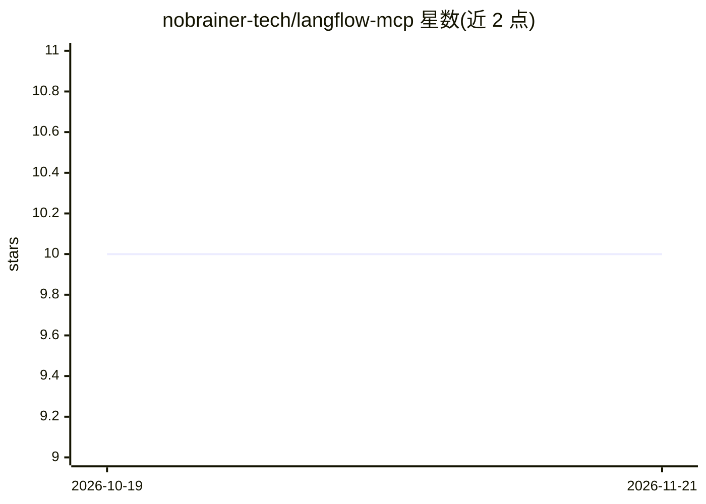

# nobrainer-tech/langflow-mcp

⭐ 10 · TypeScript · MIT · 推送 2026-11-16 · [GitHub](https://github.com/nobrainer-tech/langflow-mcp) · [官网](https://nobrainer.tech/langflow-mcp/) · 个人维护

**让 AI 助手通过 MCP 管理 Langflow 的服务器**

一个 MCP 服务器，把 Claude Code、Codex、Claude Desktop 等 MCP 客户端连接到 Langflow 实例，使 agent 能通过 236 个类型化 API 操作创建、运行、版本化与管理 Langflow 流程，另提供受控的 request_api 工具访问其余端点。提供 discovery（3 个工具）、standard（238 个工具）、consolidated（31 个工具）三种工具模式以控制上下文占用，版本号随目标 Langflow 小版本对齐，支持 stdio 本地运行与带 bearer 认证的 HTTP 服务。需 Node.js 20+ 与运行中的 Langflow 实例及 API key。

## 筛选速览

| 维度 | 判定 | 备注 |
|---|---|---|
| AI 角色 | `ai-ecosystem` | LLM/agent 周边工具 |
| 许可风险 | `permissive` | MIT |
| 部署形态 | `self-host` | docker 或自建部署 |
| 模型依赖 | — | README 未给出锁定关系 |
| 硬件要求 | — | 无带数字的原话,不猜 |
| 安装摩擦 | `low` | 无编译、无系统依赖或容器化 |
| 成熟度 | — | 结构信号不足 |

## 能力要点

- 236 个类型化 Langflow API 操作封装为 MCP 工具
- discovery 模式默认仅广告 3 个工具（约 1.5 KB 目录），按需加载 schema
- 支持 stdio 与 Streamable HTTP（bearer-token 认证）两种运行方式
- npm 小版本号随目标 Langflow 小版本镜像对齐

## 适用场景

- 让 Claude Desktop / Claude Code 直接创建、运行和版本化 Langflow 流程
- 在远程以 HTTP 服务形式为多个 agent 提供统一的 Langflow 管理通道
- 在上下文受限的客户端中以 discovery/consolidated 模式减少工具目录占用

## 场景标签

`Agent 框架` `工作流自动化` · 领域:Agent 开发

## 证据(README 行号)

> L10: Connect Claude Code, Codex, Claude Desktop or any other MCP client to your Langflow instance. Your agent can create
> L12: - **Light on context.** The default discovery mode advertises three tools, about 1.5 KB of JSON instead of 150 KB, 

## 星数曲线

2026-10-19 10 → 2026-11-21 10（+0）

---
*卡片 v1 · prompt 1.4 · 生成 2026-11-19 · 置信度 high · 依据 README sha `9136da130aaa` · [字段定义](../../DATASET.md)*
