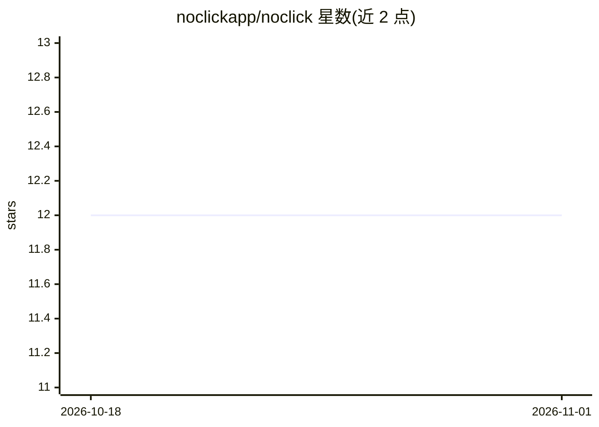

# noclickapp/noclick

⭐ 12 · Python · AGPL-3.0 · 推送 2026-10-28 · [GitHub](https://github.com/noclickapp/noclick) · [官网](https://www.noclick.com) · 组织维护

**开源 AI agent 工作流自动化平台，可视化画布+约160集成**

自托管的工作流自动化平台：在可视化画布上编排约 160 个集成（Slack、Gmail、Notion、Linear、Stripe、Postgres 等），由 webhook、定时、邮件、聊天消息触发执行。核心是 agent 层：agent 节点可驱动真实编码 CLI（Claude Code、Codex 等），把已连接集成当作工具调用，支持 OpenAI/Anthropic/OpenRouter 兼容模型。可用自然语言描述让 AI 构建器装配工作流，构建能力也通过 MCP server 暴露。整仓（引擎、编辑器、协作层、MCP server）以 AGPL 开源，并提供 noclick.com 托管云。安装需 Docker，一键脚本或 git clone + docker compose 部署，首次拉取镜像约 1.5 GB；本地开发另需 Python 3.12（3.13 不支持）、Node.js 20+、pnpm、Supabase CLI。

## 筛选速览

| 维度 | 判定 | 备注 |
|---|---|---|
| AI 角色 | `ai-ecosystem` | LLM/agent 周边工具 |
| 许可风险 | `viral` | AGPL-3.0 |
| 部署形态 | `desktop` | 安装包/桌面程序 |
| 模型依赖 | — | README 未给出锁定关系 |
| 硬件要求 | — | 无带数字的原话,不猜 |
| 安装摩擦 | `low` | 无编译、无系统依赖或容器化 |
| 成熟度 | — | 结构信号不足 |

## 能力要点

- 可视化画布编排约 160 个集成，含分支/迭代/过滤/代码节点
- agent 节点可驱动 Claude Code、Codex 等编码 CLI 并调用集成为工具
- AI 构建器支持自然语言描述装配工作流，并经 MCP server 暴露给任意 MCP 客户端
- 一键安装脚本或 docker compose 自托管，AGPL-3.0 开源

## 适用场景

- 用自然语言描述并搭建跨 Slack/Gmail/Linear 等服务的自动化流程
- 让 AI agent 读取 Linear 工单、操作 git 仓库并把结果发回 Slack
- 自托管 iPaaS 平台替代 SaaS 订阅运行工作流

## 场景标签

`工作流自动化` `Agent 框架` · 领域:Agent 开发

## 证据(README 行号)

> L71: friends. What makes it different is the agent layer: an AI agent node can drive
> L92: - **AI agents with real tools** — wire integration nodes into an agent's tool
> L94:  in-process (any OpenAI/Anthropic/OpenRouter-compatible model) or as a coding

## 星数曲线

2026-10-18 12 → 2026-11-01 12（+0）

---
*卡片 v1 · prompt 1.4 · 生成 2026-11-01 · 置信度 mid · 依据 README sha `e62099c1b6ad` · [字段定义](../../DATASET.md)*
