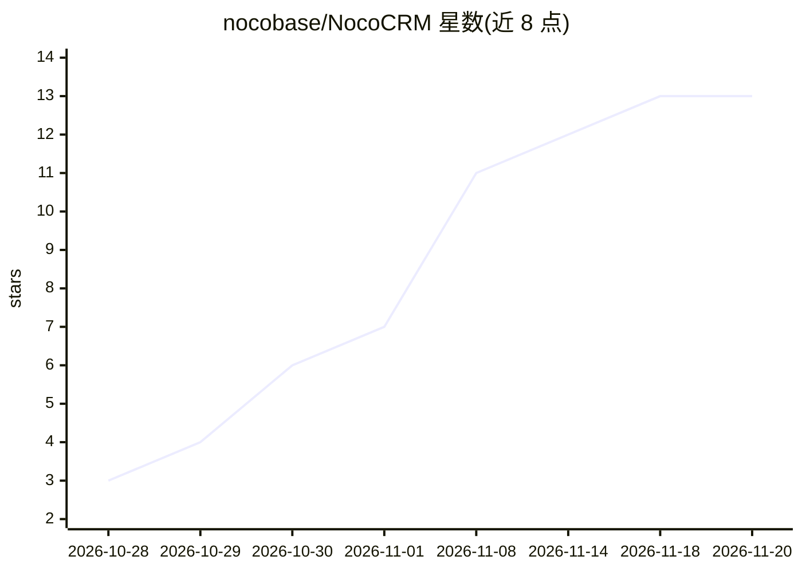

# nocobase/NocoCRM

⭐ 13 · TypeScript · NOASSERTION · 推送 2026-11-12 · [GitHub](https://github.com/nocobase/NocoCRM) · [官网](https://www.nocobase.com/solution-crm) · 组织维护 · 中文 README

**基于 NocoBase 的开源 B2B 销售 CRM，内置 6 个销售 Agent**

构建在 NocoBase 上的开源 B2B 销售 CRM，覆盖线索、公司、联系人、商机、任务、审批与报表的完整销售流程，含管道看板、任务日历、全局搜索与按记录的角色权限。核心 AI 机制是 6 个销售 Agent：线索跟进、商机跟进、审批审查、任务准备、公司调研，Agent 读取上下文后生成带置信度与理由的建议，写入需用户接受后才生效；另支持邮件/WhatsApp 通道统一时间线、名片/邮件智能转线索、每日公司信号检索。集成邮件与 WhatsApp，AI 部分需配置模型服务，其余功能无需模型即可运行。

## 筛选速览

| 维度 | 判定 | 备注 |
|---|---|---|
| AI 角色 | `ai-enhanced` | 去掉 AI 部分产品仍成立 |
| 许可风险 | `none` | NOASSERTION |
| 部署形态 | `library` | 以包/库形式分发 |
| 模型依赖 | — | README 未给出锁定关系 |
| 硬件要求 | — | 无带数字的原话,不猜 |
| 安装摩擦 | `low` | 无编译、无系统依赖或容器化 |
| 成熟度 | — | 结构信号不足 |

## 能力要点

- 6 个销售 Agent（前台 Sales Expert + 5 个后台 Agent），各自带触发器、技能与运行记录
- Agent 建议制模式：记录仅在用户接受后变更
- 邮件（Gmail/IMAP/SMTP）与 WhatsApp 消息统一匹配到线索时间线
- 商业指引以纯文本编写，各 Agent 遵循；Agent 技能可编辑

## 适用场景

- 让 Agent 自动跟进线索与商机并把下一步动作发到收件箱
- 把粘贴的邮件、聊天记录或名片转成待审核的线索
- 每天自动检索重点公司动态并触发商机跟进

## 场景标签

`AI 助手` · 领域:对话与助手

## 证据(README 行号)

> L15: NocoCRM is an open-source B2B sales CRM built on NocoBase. It comes with 6 sales agents and integrates your email a
> L63: Add a model service with its key on **Agent team → Models**, such as DeepSeek, OpenAI, Claude, Gemini or Qwen. The 
> L70: NocoCRM is built on NocoBase and released under the NocoBase License.

## 星数曲线

2026-10-28 3 → 2026-11-20 13（+10）

---
*卡片 v1 · prompt 1.4 · 生成 2026-11-18 · 置信度 high · 依据 README sha `c36dabd8db0f` · [字段定义](../../DATASET.md)*
