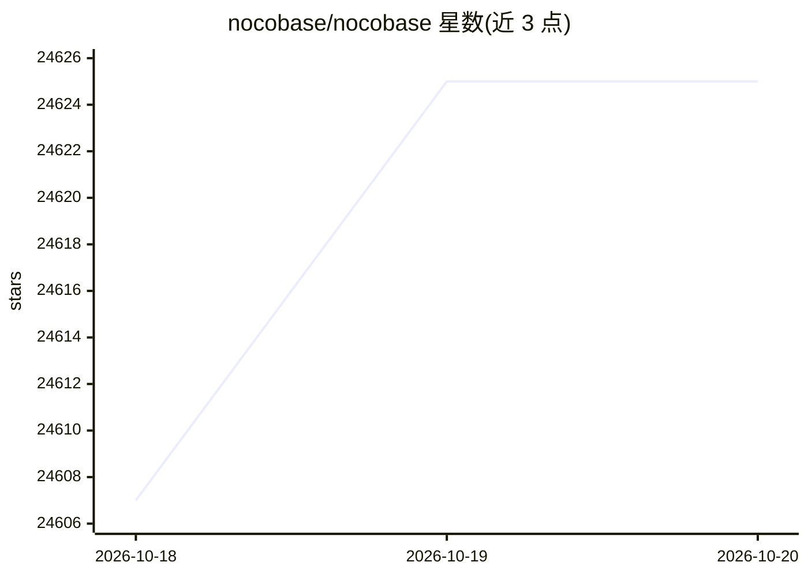

# nocobase/nocobase

⭐ 24,625 · TypeScript · NOASSERTION · 推送 2026-10-19 · [GitHub](https://github.com/nocobase/nocobase) · [官网](https://www.nocobase.com) · 组织维护 · 中文 README

**AI + 无代码平台：快速搭建企业业务系统**

开源无代码平台，以数据模型驱动方式提供内置的数据建模、权限、工作流与审计日志模块。AI 侧包含两类机制：一是与主流编码 Agent 配合的 CLI 与 skills，使 AI 可承担部署、开发、迁移、发布；二是运行在系统内的 AI 员工，接入业务工作流执行表单填写、文档识别、任务路由等任务。所有 AI 操作遵循与人类用户相同的细粒度权限，并记录审计日志。通过 MCP、HTTP API、CLI 开放接口连接外部 Agent 平台。数据保存在用户自有数据库中，插件采用微内核架构。

## 筛选速览

| 维度 | 判定 | 备注 |
|---|---|---|
| AI 角色 | `ai-enhanced` | 去掉 AI 部分产品仍成立 |
| 许可风险 | `none` | NOASSERTION |
| 部署形态 | `library` | 以包/库形式分发 |
| 模型依赖 | — | README 未给出锁定关系 |
| 硬件要求 | — | 无带数字的原话,不猜 |
| 安装摩擦 | `low` | 无编译、无系统依赖或容器化 |
| 成熟度 | — | 结构信号不足 |

## 动量与使用信号

- 维护:`active` — 距上次 push 0.6 天,年发版 100,106 位贡献者
- 涨星:近 1 天 **+11**(自 20261016 起算)
- 安装:npm 包 `@nocobase/cli` 月下载 19,601
- 平台:— · 协议:MCP

## 能力要点

- AI 编码代理（Claude Code、Cursor、Codex、OpenCode、TRAE）通过 CLI 与 skills 端到端处理部署、开发、迁移、发布
- 系统内 AI 员工自动获取业务上下文并执行前端分析与后端任务
- MCP、HTTP API、CLI 标准接口连接 OpenClaw、Hermes、Dify、Coze、n8n 等平台
- 数据模型、权限、工作流、审计日志开箱即用，微内核插件架构

## 适用场景

- 为团队快速搭建内部管理工具、CRM、ERP 等业务系统
- 让 AI 员工加入工作流，处理文档识别与任务路由
- 在权限受控的前提下让外部 Agent 安全查询数据、触发业务动作
- 无代码界面下可视化配置数据模型、页面与权限

## 场景标签

`工作流自动化` · 领域:效率与自动化

## 证据(README 行号)

> L12: NocoBase is an open-source AI + no-code platform for building business systems fast. Instead of generating everythi
> L49: Coding agents get a full CLI and skills, while people get a WYSIWYG no-code interface, so both can collaborate effi
> L82: NocoBase includes AI employees, so AI can work directly inside the system.

## 星数曲线

2026-10-18 24,607 → 2026-10-20 24,625（+18）

---
*卡片 v1 · prompt 1.4 · 生成 2026-10-18 · 置信度 high · 依据 README sha `723b1e43c8fe` · [字段定义](../../DATASET.md)*
