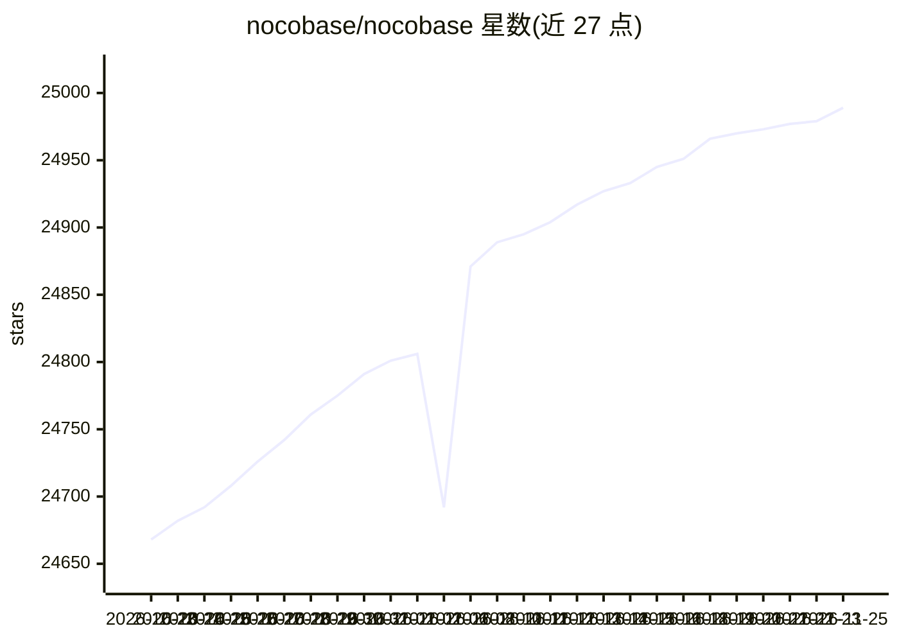

# nocobase/nocobase

⭐ 24,989 · TypeScript · NOASSERTION · 推送 2026-11-24 · [GitHub](https://github.com/nocobase/nocobase) · [官网](https://www.nocobase.com) · 组织维护 · 中文 README

**AI 代理参与构建业务系统的开源无代码平台**

NocoBase 是一个用于构建、运行和演进业务系统的开源无代码平台，定位为让 AI 代理编写代码、平台提供基础与治理、人做决策。生态包含三部分：NocoBase Core 提供权限、工作流、文件等现成构建块；NocoBase Studio 将 Claude Code、Codex、OpenCode 纳入同一代理团队进行任务推进与治理；NocoBase Solution 为基于 Core 的代理驱动业务应用。运行要求 Node.js 24+ 与 pnpm 11，Windows 需 WSL，默认示例使用 SQLite。

## 筛选速览

| 维度 | 判定 | 备注 |
|---|---|---|
| AI 角色 | `ai-enhanced` | 去掉 AI 部分产品仍成立 |
| 许可风险 | `none` | NOASSERTION |
| 部署形态 | `library` | 以包/库形式分发 |
| 模型依赖 | — | README 未给出锁定关系 |
| 硬件要求 | — | 无带数字的原话,不猜 |
| 安装摩擦 | `low` | 无编译、无系统依赖或容器化 |
| 成熟度 | — | 结构信号不足 |

## 动量与使用信号

- 维护:`active` — 距上次 push 0.6 天,年发版 100,106 位贡献者
- 涨星:近 1 天 **+11**(自 20261016 起算)
- 安装:npm 包 `@nocobase/cli` 月下载 19,601
- 平台:— · 协议:MCP

## 能力要点

- 通过 npx 安装 Skill 后由编码代理创建并启动应用
- NocoBase Studio 将 Claude Code/Codex/OpenCode 组成统一代理团队
- Core 内置权限、工作流、文件等业务系统基础构件
- 终端路径使用 pnpm create 创建应用，默认 SQLite 无需独立数据库

## 适用场景

- 让编码代理在统一架构上搭建内部业务系统
- 团队与多个 AI 代理协作开发并保留人工关键决策
- 通过治理平台跟踪多项目多代理的进度

## 场景标签

`编码 Agent` · 领域:编码与开发

## 证据(README 行号)

> L8: NocoBase is the open-source platform for building, running, and evolving business systems with AI. Agents write the 
> L74:  NocoBase Core is the open-source application foundation for business systems built and run with AI. Permissions, w
> L80:  NocoBase Studio is the governance platform for people and agents building software together. It brings Claude Code

## 星数曲线

2026-10-23 24,668 → 2026-11-25 24,989（+321）

---
*卡片 v1 · prompt 1.4 · 生成 2026-11-22 · 置信度 mid · 依据 README sha `8c8f5253b9e7` · [字段定义](../../DATASET.md)*
