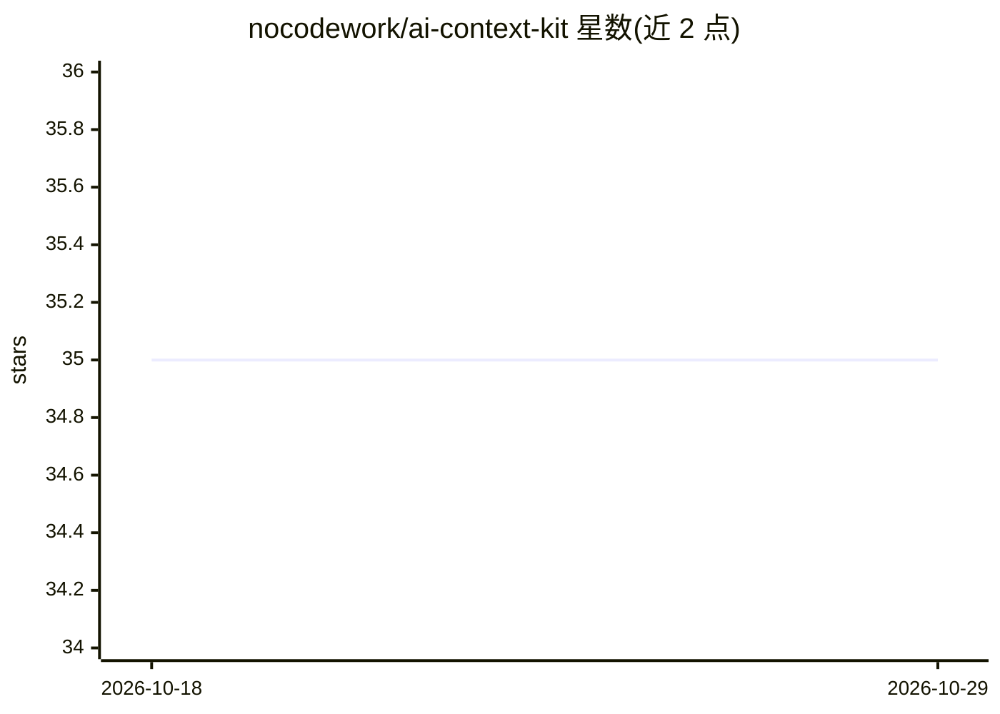

# nocodework/ai-context-kit

⭐ 35 · Shell · MIT · 推送 2026-10-16 · [GitHub](https://github.com/nocodework/ai-context-kit) · [官网](https://nocodework.io) · 组织维护

**一次编写个人/公司上下文 Markdown，复用于各 AI 工具**

由 NoCodeWork 维护的上下文模板工具包：通过两个 Claude Code skill（personal-context / company-context）以引导式访谈生成 Markdown 上下文文件，也提供纯模板供非 Claude Code 用户手工填写。生成的文件可粘贴或配置到 ChatGPT、Claude、Gemini、Cursor、CLAUDE.md、AGENTS.md 等位置复用。skill 支持多语言访谈输出，可用 refresh 更新已有文件。MIT 许可。

## 筛选速览

| 维度 | 判定 | 备注 |
|---|---|---|
| AI 角色 | `ai-ecosystem` | LLM/agent 周边工具 |
| 许可风险 | `permissive` | MIT |
| 部署形态 | `None` |  |
| 模型依赖 | locked-api |  |
| 硬件要求 | — | 无带数字的原话,不猜 |
| 安装摩擦 | `low` | 无编译、无系统依赖或容器化 |
| 成熟度 | — | 结构信号不足 |

## 能力要点

- 两个 Claude Code skill 以引导访谈生成 personal-context.md / company-context.md
- 无需 Claude Code 时可直接填写 Markdown 模板
- 提供 ChatGPT/Claude/Gemini/Cursor/Agent CLI 等各工具的接入位置说明
- 支持 refresh 更新已有上下文文件，提供英文与波兰文示例

## 适用场景

- 把个人与公司信息写成一份文件，避免每次对话重复输入
- 让 ChatGPT/Claude/Cursor 等工具的回答保持一致的语气与背景
- 为团队沉淀公司定位、客户画像等常问信息供 AI 引用

## 场景标签

`提示工程` · 领域:Agent 开发

## 证据(README 行号)

> L5: Build a reusable **context file about you and your company**, once — then drop it into any AI tool so every answer i
> L26: **With Claude Code (guided interview):** install a skill, run it, answer a short set of questions. The skill probes
> L31: /plugin install ai-context-kit --marketplace nocodework/ai-context-kit

## 星数曲线

2026-10-18 35 → 2026-10-29 35（+0）

---
*卡片 v1 · prompt 1.4 · 生成 2026-10-25 · 置信度 high · 依据 README sha `10c677703efc` · [字段定义](../../DATASET.md)*
