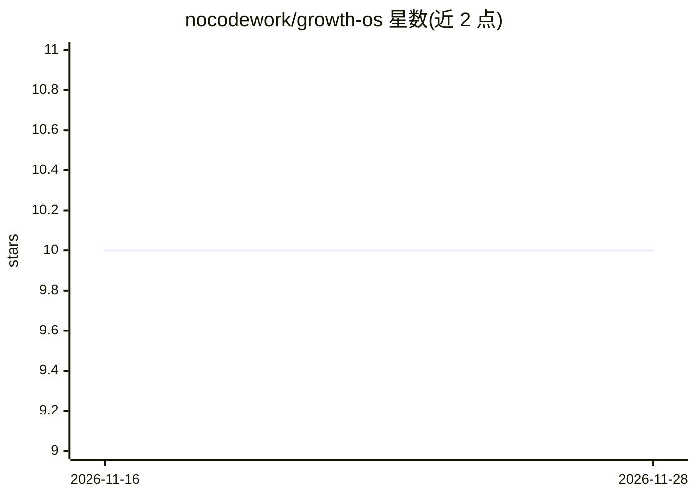

# nocodework/growth-os

⭐ 10 · Python · MIT · 推送 2026-10-16 · [GitHub](https://github.com/nocodework/growth-os) · 组织维护

**开源增长审计系统：让 AI agent 基于真实数据做增长审计与营销任务**

NoCodeWork 出的增长操作系统：将业务 URL 的定位（USP/UVP/ICP）提取并持久化到上下文文件，运行覆盖技术 SEO、页面速度、GEO/AI 可见性、竞品与 GA4/GSC 实时基线的增长审计，再将具体任务委托给原子化营销技能。以 Claude Code 插件分发，核心由 Markdown 技能、Python CLI 与 MCP 服务器组成，可在 Codex、Hermes 等运行时使用。v1 仅读取数据，不写回广告账户或 CMS；默认自托管、零遥测、MIT 许可。

## 筛选速览

| 维度 | 判定 | 备注 |
|---|---|---|
| AI 角色 | `ai-native` | 本体是模型或模型工具 |
| 许可风险 | `permissive` | MIT |
| 部署形态 | `library` | 以包/库形式分发 |
| 模型依赖 | — | README 未给出锁定关系 |
| 硬件要求 | — | 无带数字的原话,不猜 |
| 安装摩擦 | `low` | 无编译、无系统依赖或容器化 |
| 成熟度 | — | 结构信号不足 |

## 能力要点

- 从 URL 提取 USP/UVP/ICP 并持久化到 .agents/product-marketing.md
- 审计覆盖 SEO、PageSpeed、GEO/AI 可见性、竞品与 GA4/GSC 实时数据
- 可移植核心：Markdown 技能 + Python CLI + MCP 服务器，跨运行时复用
- 集成使用用户自己的密钥，只读设计，零遥测

## 适用场景

- 为业务站点做定位提取与全链路增长审计
- 让 AI agent 基于 GA4/GSC 真实数据生成增长建议
- 检查品牌在 ChatGPT/Perplexity 等 AI 回答中的可见性

## 场景标签

`工作流自动化` `数据分析` `AI 写作` · 领域:效率与自动化

## 证据(README 行号)

> L5: **The open-source Growth OS for any AI agent.**
> L31: 2. **Audits growth** — technical SEO, page speed (via Google's PageSpeed Insights API), GEO / AI-visibility (how yo
> L123: - **The `growth-os` CLI** — a Python command that does the read-side data pulls: `growth-os <adapter> <cmd>`, e.g.

## 星数曲线

2026-11-16 10 → 2026-11-28 10（+0）

---
*卡片 v1 · prompt 1.4 · 生成 2026-11-19 · 置信度 high · 依据 README sha `1067bb43ea39` · [字段定义](../../DATASET.md)*
