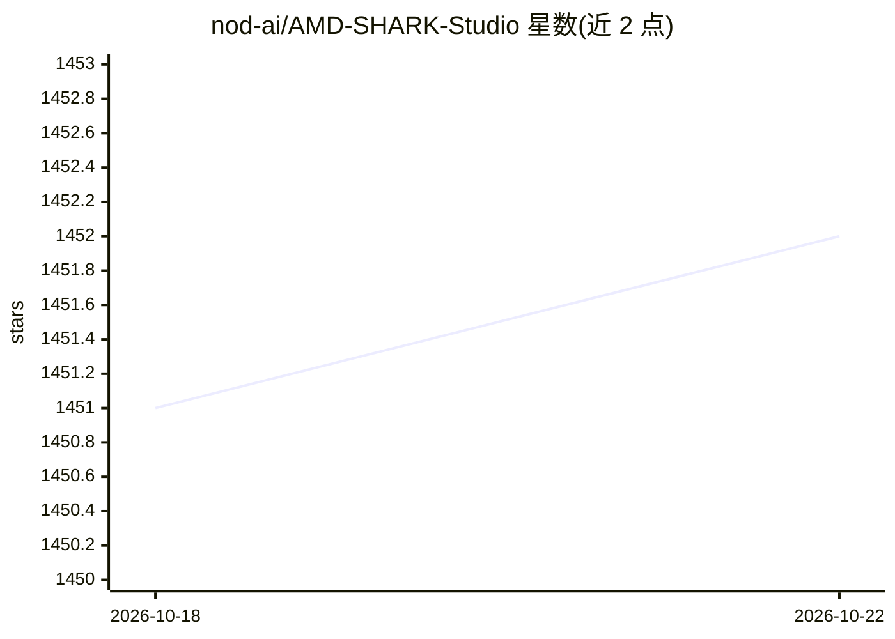

# nod-ai/AMD-SHARK-Studio

⭐ 1,452 · Python · Apache-2.0 · 推送 2025-12-15 · [GitHub](https://github.com/nod-ai/AMD-SHARK-Studio) · 组织维护

**基于 SHARK+IREE 的 ML 推理与 Stable Diffusion Web UI 发行版**

由 nod-ai（AMD 体系团队）开发的机器学习发行版：以 SHARK 与 IREE/Torch-MLIR 为后端，提供浏览器端 Stable Diffusion 文生图 Web UI 与命令行推理，支持 Vulkan/CUDA/CPU/Metal 多后端，覆盖 AMD RDNA、NVIDIA 与 Apple Silicon 显卡。附带 Python API、pytest 模型测试框架（数百个 tank 模型）与逐 dispatch 编译基准输出。README 明确声明项目当前不再维护，最新代码是向 IREE-Turbine 重构的过渡版本，需使用 AMDSHARK-1.0 分支或 .exe 发行版。

## 筛选速览

| 维度 | 判定 | 备注 |
|---|---|---|
| AI 角色 | `ai-ecosystem` | LLM/agent 周边工具 |
| 许可风险 | `permissive` | Apache-2.0 |
| 部署形态 | `desktop` | 安装包/桌面程序 |
| 模型依赖 | — | README 未给出锁定关系 |
| 硬件要求 | — | 无带数字的原话,不猜 |
| 安装摩擦 | `medium` | 含编译或系统依赖之一 |
| 成熟度 | — | 结构信号不足 |

## 能力要点

- Stable Diffusion Web UI，支持 Vulkan/CUDA/CPU/Metal 后端
- Python AMDSharkInference API 导入并运行 MHLO/MLIR 模型
- 数百个 tank 模型的 pytest 测试框架与逐 dispatch 基准（.mlir/.vmfb 产物）
- 验证支持 BERT、GPT2、BLOOM、ResNet50、ViT 等模型（CPU/CUDA/Metal）

## 适用场景

- 在 AMD/NVIDIA/Apple 显卡上本地运行 Stable Diffusion 文生图
- 用 Python API 加载并运行 MLIR/MHLO 模型做推理
- 对模型 dispatch 做编译级延迟基准测试

## 场景标签

`图像生成` `推理引擎` · 领域:内容生成

## 证据(README 行号)

> L3: High Performance Machine Learning Distribution
> L120: (amdshark1.venv) PS C:\g\amdshark> python .\apps\stable_diffusion\scripts\main.py --app="txt2img" --precision="fp1
> L168: pip install nodai-amdshark -f https://nod-ai.github.io/AMD-SHARK-Studio/package-index/ -f https://llvm.github.io/t

## 星数曲线

2026-10-18 1,451 → 2026-10-22 1,452（+1）

---
*卡片 v1 · prompt 1.4 · 生成 2026-10-21 · 置信度 mid · 依据 README sha `fb58ec764a90` · [字段定义](../../DATASET.md)*
