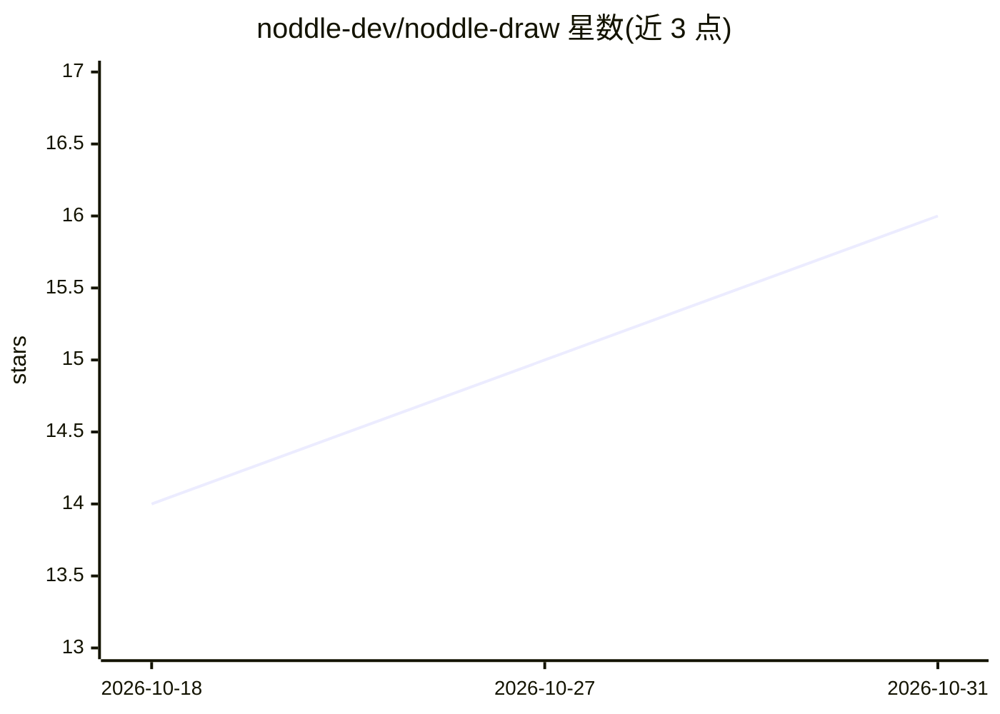

# noddle-dev/noddle-draw

⭐ 16 · TypeScript · MIT · 推送 2026-10-03 · [GitHub](https://github.com/noddle-dev/noddle-draw) · [官网](https://draw.noddle.dev) · 组织维护

**匿名协作画板：无需登录即画，AI 可代改图（BYOK）**

开源匿名架构图/白板协作应用：打开站点即可绘图，画板 URL 即分享能力，支持共享光标实时协作、形状置顶评论、版本历史与恢复。提供 47 种图形、云厂商图标模板、A* 自动布线连接线与动画效果，可导出 SVG/PNG/GIF/Mermaid 等。AI 联合编辑器（自带 API key）支持对话改图、Mermaid/照片转图，密钥仅存浏览器；另含 MCP server 供 agent 通过 REST API 编辑画板。可通过 Docker 一条命令自托管。

## 筛选速览

| 维度 | 判定 | 备注 |
|---|---|---|
| AI 角色 | `ai-enhanced` | 去掉 AI 部分产品仍成立 |
| 许可风险 | `permissive` | MIT |
| 部署形态 | `self-host` | docker 或自建部署 |
| 模型依赖 | locked-api |  |
| 硬件要求 | — | 无带数字的原话,不猜 |
| 安装摩擦 | `low` | 无编译、无系统依赖或容器化 |
| 成熟度 | — | 结构信号不足 |

## 能力要点

- 免注册链接分享与 WebSocket 实时协作（光标/评论/版本历史）
- AI 联合编辑器 BYOK：对话改图、Mermaid/照片转图、右键 AI 增强
- 内置 MCP server，agent 可通过 REST API 编辑画板
- Docker 一键自托管，无 DATABASE_URL 时降级为文件存储

## 适用场景

- 团队临时共享白板讨论架构图，无需账号
- 把白板照片或 Mermaid 文本转成可编辑图形
- 让 AI 按自然语言指令修改架构图
- 自托管部署作为内部图表协作工具

## 场景标签

 · 领域:协作工具/图表绘制

## 证据(README 行号)

> L9: **Open-source anonymous diagram board** — structured shapes and smart
> L11: Excalidraw, plus an AI co-editor that edits the board with you (bring your
> L27:  AI-Noddle chat (BYOK) : describe a change, and the board is edited for you. Your own key stays in your browser. Th

## 星数曲线

2026-10-18 14 → 2026-10-31 16（+2）

---
*卡片 v1 · prompt 1.4 · 生成 2026-10-30 · 置信度 mid · 依据 README sha `bddee14b8950` · [字段定义](../../DATASET.md)*
