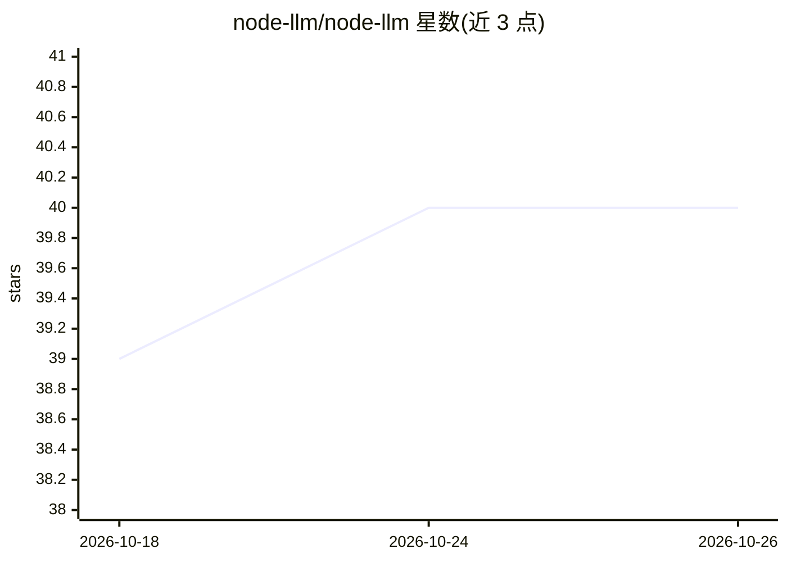

# node-llm/node-llm

⭐ 40 · TypeScript · MIT · 推送 2026-10-16 · [GitHub](https://github.com/node-llm/node-llm) · [官网](https://nodellm.dev) · 组织维护

**Node.js 的多提供商 LLM 后端编排 SDK，统一 540+ 模型 API**

面向 Node.js 后端的 LLM 编排 SDK：将 OpenAI、Anthropic、Gemini、DeepSeek、Bedrock、Ollama 等提供商统一到单一 API，通过配置切换提供商。能力覆盖流式与工具调用的跨模型一致性契约、Zod 结构化输出、图像生成、音频转录、视觉与文件输入、MCP 协议接入、ORM 持久化（Prisma）、中间件（审计/成本/PII 脱敏）与 VCR 式录制回放测试。定位后端运行时，明确声明不是厂商 SDK 薄封装或前端流式库。MIT 许可，TypeScript 编写。

## 筛选速览

| 维度 | 判定 | 备注 |
|---|---|---|
| AI 角色 | `ai-ecosystem` | LLM/agent 周边工具 |
| 许可风险 | `permissive` | MIT |
| 部署形态 | `library` | 以包/库形式分发 |
| 模型依赖 | local-ok | 支持本地模型 |
| 硬件要求 | — | 无带数字的原话,不猜 |
| 安装摩擦 | `low` | 无编译、无系统依赖或容器化 |
| 成熟度 | — | 结构信号不足 |

## 能力要点

- 统一 API 接入 540+ 模型、多个提供商经配置切换
- 流式+工具调用跨模型契约一致，支持 Zod 结构化输出
- MCP 协议接入与 @node-llm/orm 持久化（Postgres/MySQL/SQLite）
- 中间件机制支持审计、成本追踪与 PII 脱敏

## 适用场景

- Node.js 后端服务统一接入多家 LLM 提供商
- 构建可测试、可回放的 LLM 生产系统
- 让同一套代码在云 API 与本地 Ollama 间切换

## 场景标签

`模型网关` · 领域:Agent 开发

## 证据(README 行号)

> L9: **NodeLLM is a backend orchestration layer designed for building reliable, testable, and provider-agnostic AI system
> L11: Integrating multiple LLM providers often means juggling different SDKs, API styles, and update cycles. NodeLLM give
> L53: - ✅ **A Backend Runtime**: Designed for workers, cron jobs, agents, and API servers.

## 星数曲线

2026-10-18 39 → 2026-10-26 40（+1）

---
*卡片 v1 · prompt 1.4 · 生成 2026-10-25 · 置信度 high · 依据 README sha `ceb1cab2acf3` · [字段定义](../../DATASET.md)*
