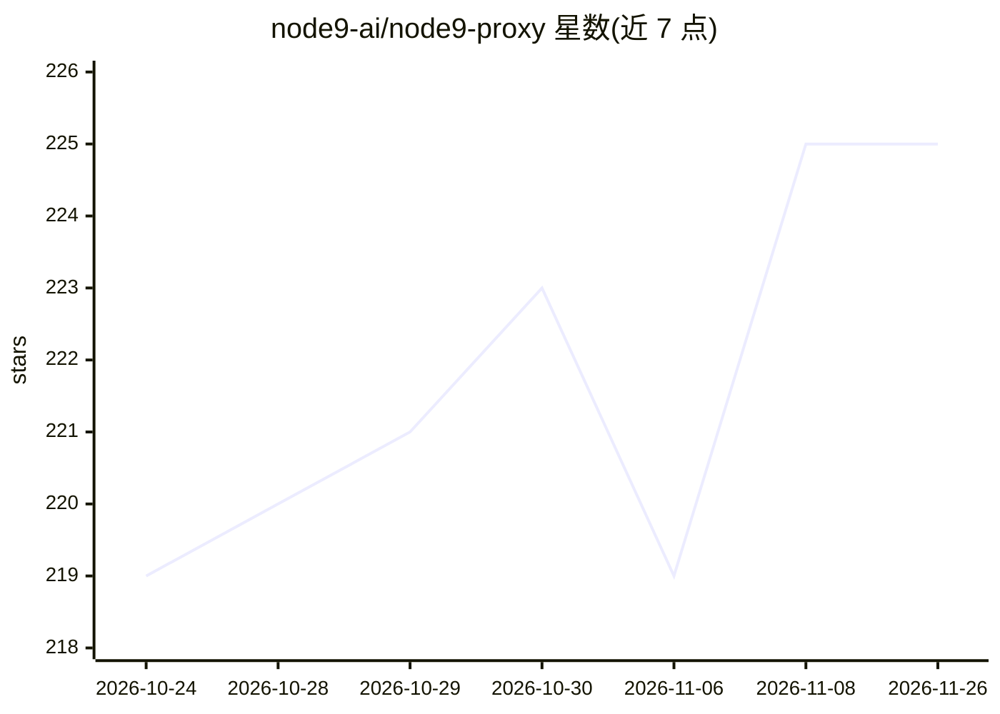

# node9-ai/node9-proxy

⭐ 225 · TypeScript · Apache-2.0 · 推送 2026-11-25 · [GitHub](https://github.com/node9-ai/node9-proxy) · [官网](https://node9.ai/) · 组织维护

**给 AI 编码代理做访问控制与操作审计的安全网关**

node9 是面向 AI 编码代理的访问控制工具，以 CLI、MCP 服务器和 GitHub Action 三种方式提供：扫描仓库中的 agent 配置、工作流与 MCP 设置并给出风险报告；在代理与工具调用之间作为门禁，按规则放行、拦截或暂扣（凭证监禁、DLP/PII、网络出站白名单、破坏性命令审批）；将多台机器汇总为 OWASP Agentic Top 10 报告。本地保护无需账号，Apache 2.0 许可，需 Node.js 22+。

## 筛选速览

| 维度 | 判定 | 备注 |
|---|---|---|
| AI 角色 | `ai-ecosystem` | LLM/agent 周边工具 |
| 许可风险 | `permissive` | Apache-2.0 |
| 部署形态 | `library` | 以包/库形式分发 |
| 模型依赖 | — | README 未给出锁定关系 |
| 硬件要求 | — | 无带数字的原话,不猜 |
| 安装摩擦 | `low` | 无编译、无系统依赖或容器化 |
| 成熟度 | — | 结构信号不足 |

## 能力要点

- 对每次工具调用做允许/拦截/暂扣判定，凭证路径读取默认阻断，命令经 shell AST 解析
- 以 MCP 服务器形式运行，任何 MCP 客户端可通过 stdio 接入
- GitHub Action 在每个 PR 上扫描 agent 配置并输出检查、评论与标注
- 多机汇总为 OWASP Agentic Top 10 报告，支持 Slack/Dashboard 审批

## 适用场景

- 为团队的 Claude Code、Codex 等代理统一设置可执行操作边界
- 在 PR 中自动检测可被外部操控的 agent 工作流配置
- 拦截代理读取 SSH 密钥、.env、云凭证等敏感文件
- 生成 OWASP Agentic Top 10 合规报告向团队说明安全态势

## 场景标签

`网络安全` · 领域:学习与行业

## 证据(README 行号)

> L2:  Access control for AI agents
> L117: node9 sits between an agent and every tool it calls: files, commands, the network and every
> L30: **node9 Agent Security**.

## 星数曲线

2026-10-24 219 → 2026-11-26 225（+6）

---
*卡片 v1 · prompt 1.4 · 生成 2026-11-25 · 置信度 high · 依据 README sha `5416180e1e67` · [字段定义](../../DATASET.md)*
