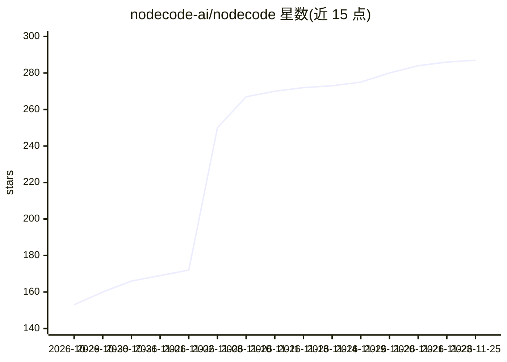

# nodecode-ai/nodecode

⭐ 287 · Common Lisp · MIT · 推送 2026-11-23 · [GitHub](https://github.com/nodecode-ai/nodecode) · [官网](https://nodecode.ai) · 组织维护

**用 Lisp 自我改写的终端编码 agent，随使用演化**

以单个 SBCL（Common Lisp）进程运行的终端 agent：模型只有一个工具，即在运行中的程序里求值 Lisp，自定义义的代码被保留、逐文件提交到 git，并在每次启动时加载。发布版本大多无需重启即可在运行中的程序里生效，可用 generations/rollback 回退。功能以"cell"文件夹为单位扩展（聊天机器人、MCP 服务器、定时任务、多会话协作等），提供本地网关供终端、浏览器、手机、Discord/Telegram/Slack bot 与 RPC 客户端接入。MIT 许可，使用用户自己的 provider key 计费。README 声明其不自带沙箱，eval 以用户账户全部权限运行。

## 筛选速览

| 维度 | 判定 | 备注 |
|---|---|---|
| AI 角色 | `ai-ecosystem` | LLM/agent 周边工具 |
| 许可风险 | `permissive` | MIT |
| 部署形态 | `None` |  |
| 模型依赖 | — | README 未给出锁定关系 |
| 硬件要求 | — | 无带数字的原话,不猜 |
| 安装摩擦 | `low` | 无编译、无系统依赖或容器化 |
| 成熟度 | — | 结构信号不足 |

## 能力要点

- 模型唯一工具为 eval：在运行的 SBCL 进程中求值 Lisp 并持久化定义
- 运行中热更新，支持 nodecode generations/rollback 版本管理
- cell 机制扩展 bot、MCP、cron、多会话协作等能力，可从 hub 安装或让 agent 自己编写
- 网关使终端/浏览器/手机/Discord/Telegram/Slack/RPC 共享同一运行实例

## 适用场景

- 在终端里用自然语言驱动编码任务
- 通过 Discord/Telegram/Slack 机器人远程与 agent 交互
- 让 agent 自行编写缺失的工具与技能
- 定时运行提示词与多会话协作完成任务

## 场景标签

`编码 Agent` · 领域:编码与开发

## 证据(README 行号)

> L22: Nodecode is an agent that rewrites itself. It runs as one process in SBCL, a Common Lisp system, and shells attach 
> L38: Then run `nodecode`. The first launch opens setup. If another coding agent lives on the machine (Claude Code, Codex
> L121: Any provider that speaks one of four wire dialects: `openai-completions`, `openai-responses`, `anthropic` or `goog

## 星数曲线

2026-10-29 153 → 2026-11-25 287（+134）

---
*卡片 v1 · prompt 1.4 · 生成 2026-11-25 · 置信度 high · 依据 README sha `30c02c980353` · [字段定义](../../DATASET.md)*
