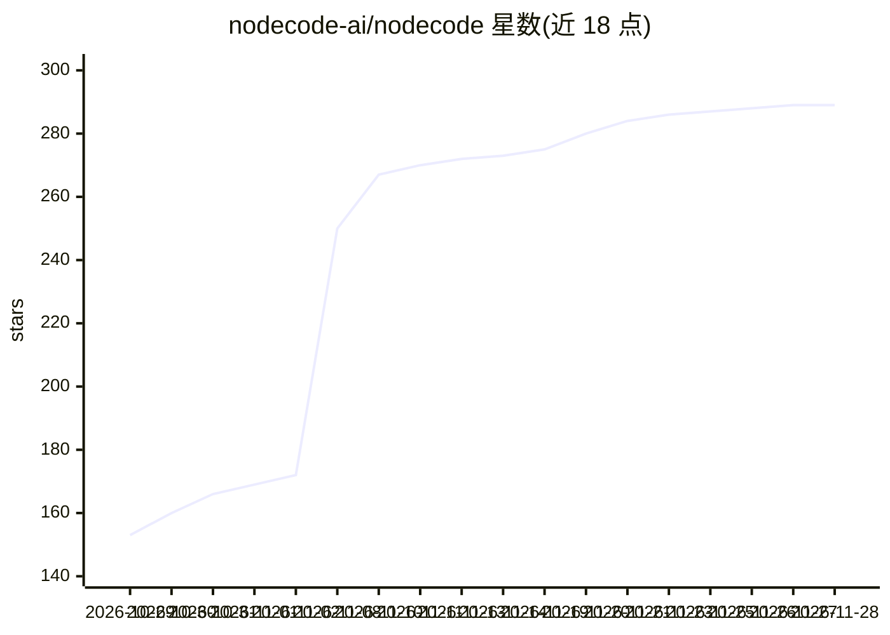

# nodecode-ai/nodecode

⭐ 289 · Common Lisp · MIT · 推送 2026-11-27 · [GitHub](https://github.com/nodecode-ai/nodecode) · [官网](https://nodecode.ai) · 组织维护

**自我改写的 Lisp 编码 agent，运行于 SBCL 单进程**

Nodecode 是一个以 SBCL Common Lisp 单进程运行的 agent，模型唯一工具是在运行中的程序里求值 Lisp，所定义内容即时生效并以 git 提交保存，实现运行中自我更新（含 generations/rollback）。通过 cell 文件夹扩展能力（bot、MCP、定时任务、多会话协作等），本地网关让终端、浏览器、手机、Discord/Telegram/Slack 机器人与 RPC 客户端共用同一实例。Linux/macOS 用安装脚本，Windows 用 PowerShell 脚本；README 明确说明无沙箱，建议在容器或 VM 中运行。

## 筛选速览

| 维度 | 判定 | 备注 |
|---|---|---|
| AI 角色 | `ai-native` | 本体是模型或模型工具 |
| 许可风险 | `permissive` | MIT |
| 部署形态 | `None` |  |
| 模型依赖 | — | README 未给出锁定关系 |
| 硬件要求 | — | 无带数字的原话,不猜 |
| 安装摩擦 | `low` | 无编译、无系统依赖或容器化 |
| 成熟度 | — | 结构信号不足 |

## 能力要点

- 模型唯一工具为 eval：在运行中的 SBCL 进程里求值 Lisp 并保留定义
- cell 机制扩展功能：bot、MCP、cron、多会话 team/board 等
- 网关支持终端、浏览器、手机、Discord/Telegram/Slack、RPC 多客户端
- 支持运行中热更新、generations 回滚与 --pristine 运行

## 适用场景

- 让 agent 在终端里读写代码并自行定义缺失的工具
- 通过 Discord/Telegram 机器人随时与同一个 agent 会话
- 从已有编码 agent 迁移密钥、记忆、技能与 MCP 配置

## 场景标签

`编码 Agent` · 领域:编码与开发

## 证据(README 行号)

> L19: Nodecode is an agent that rewrites itself. It runs as one process in SBCL, a Common Lisp system, and shells attach 
> L61: *"Its programs are in the same format as its data."* (John McCarthy, 1984). Code is data, so a program can rewrite 

## 星数曲线

2026-10-29 153 → 2026-11-28 289（+136）

---
*卡片 v1 · prompt 1.4 · 生成 2026-11-28 · 置信度 high · 依据 README sha `fb9b2f59b6fb` · [字段定义](../../DATASET.md)*
