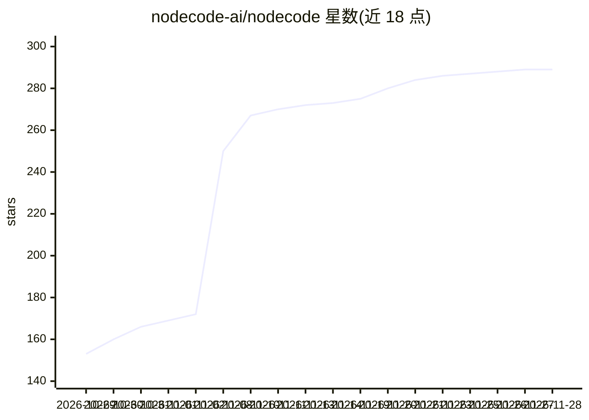

# nodecode-ai/nodecode

⭐ 289 · Common Lisp · MIT · 推送 2026-11-27 · [GitHub](https://github.com/nodecode-ai/nodecode) · [官网](https://nodecode.ai) · 组织维护

**可自我改写的 Lisp 终端 AI 编码代理，多客户端接入**

以单个 SBCL 进程运行的 Common Lisp 编码代理：模型仅有一个工具——在运行中的程序里求值 Lisp 表达式，其定义即时生效、逐文件保存并以 git 提交，实现运行中自更新与 `nodecode rollback` 版本回滚。功能以「cell」文件夹形式扩展（Discord/Telegram/Slack 机器人、浏览器/手机接入、MCP、定时任务、多会话协作、PR 审查等），首次启动可从 Claude Code、Codex、Cursor CLI 等既有代理导入密钥、指令与记忆。MIT 许可，提供 Linux/macOS/Windows 安装脚本与源码构建路径。

## 筛选速览

| 维度 | 判定 | 备注 |
|---|---|---|
| AI 角色 | `ai-native` | 本体是模型或模型工具 |
| 许可风险 | `permissive` | MIT |
| 部署形态 | `None` |  |
| 模型依赖 | — | README 未给出锁定关系 |
| 硬件要求 | — | 无带数字的原话,不猜 |
| 安装摩擦 | `low` | 无编译、无系统依赖或容器化 |
| 成熟度 | — | 结构信号不足 |

## 能力要点

- 单一 `eval` 工具在运行程序中求值 Lisp，定义即时生效并由 git 管理
- 运行中逐定义自更新，支持 generations 列表与 rollback 回滚
- cell 机制扩展机器人、MCP、定时任务、多会话团队协作等能力
- 通过四种协议方言接入任意 provider，本地服务可用 base_url 连接

## 适用场景

- 在终端通过自然语言让代理读 PDF、写工具、处理编码任务
- 通过 Discord/Telegram/Slack 机器人在聊天室里使用同一个代理
- 从既有编码代理迁移密钥、记忆与技能配置
- 让多个会话在共享文件夹中协作完成一个任务

## 场景标签

`编码 Agent` `聊天机器人` · 领域:编码与开发

## 证据(README 行号)

> L19: Nodecode is an agent that rewrites itself. It runs as one process in SBCL, a Common Lisp system, and shells attach 
> L35: Then run `nodecode`. The first launch opens setup. If another coding agent lives on the machine (Claude Code, Codex
> L61: *"Its programs are in the same format as its data."* (John McCarthy, 1984). Code is data, so a program can rewrite 

## 星数曲线

2026-10-29 153 → 2026-11-28 289（+136）

---
*卡片 v1 · prompt 1.4 · 生成 2026-11-27 · 置信度 high · 依据 README sha `84326be8e8af` · [字段定义](../../DATASET.md)*
