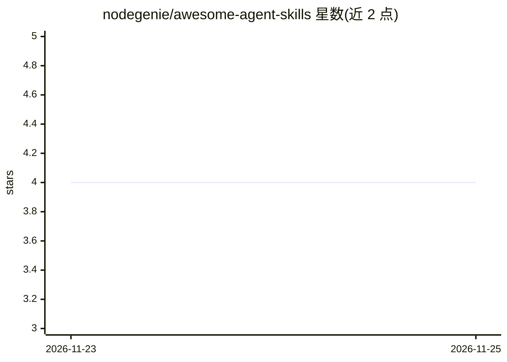

# nodegenie/awesome-agent-skills

⭐ 4 · JavaScript · NOASSERTION · 推送 2026-10-25 · [GitHub](https://github.com/nodegenie/awesome-agent-skills) · [官网](https://usethisskill.com) · 个人维护

**为 Claude Code/Codex/Cursor 提供 2,043 个 agent 技能的目录与安全扫描**

从 45 个公开仓库每周索引 agent 技能，形成按 Automation、Design、Testing、Backend 等 10 类组织的目录，并提供两项机制：一是 npx 扫描命令，检测技能文件夹中的下载执行、破坏性命令、外发数据、混淆代码、凭据访问、提权与持久化等模式，可接入 GitHub Actions 在每个 PR 上运行；二是 usethisskill.com 上的 side-by-side proof，同一 brief 下有/无技能各运行一次并保存对比页面。公共仓库扫描免费，私有仓库需 Team key。

## 筛选速览

| 维度 | 判定 | 备注 |
|---|---|---|
| AI 角色 | `ai-knowledge` | 知识聚合/清单类 |
| 许可风险 | `none` | NOASSERTION |
| 部署形态 | `library` | 以包/库形式分发 |
| 模型依赖 | — | README 未给出锁定关系 |
| 硬件要求 | — | 无带数字的原话,不猜 |
| 安装摩擦 | `medium` | 含编译或系统依赖之一 |
| 成熟度 | — | 结构信号不足 |

## 能力要点

- npx scan 检测技能文件夹中的危险模式并给出文件与行号
- GitHub Action 形式可在每个 pull request 上运行扫描
- 2,043 个技能按 10 个类别索引，每周更新
- 提供 Claude Code 插件与 MCP server 供 agent 内查询

## 适用场景

- 安装第三方 agent 技能前先扫描安全风险
- 按类别浏览为 Claude Code/Codex/Cursor 找技能
- 在 CI 中检查新增技能是否引入危险命令

## 场景标签

`精选清单` · 领域:学习与行业

## 证据(README 行号)

> L3: **2,043 agent skills** for Claude Code, Codex, Cursor and Gemini CLI, indexed weekly from 45 public repositories, ea
> L7: A skill is a folder of instructions an agent follows with your permissions. This one command checks every skill fold
> L148: A machine-readable index of the catalog is published at usethisskill.com/llms.txt and usethisskill.com/llms-full.t

## 星数曲线

2026-11-23 4 → 2026-11-25 4（+0）

---
*卡片 v1 · prompt 1.4 · 生成 2026-11-23 · 置信度 high · 依据 README sha `dee7938c261f` · [字段定义](../../DATASET.md)*
