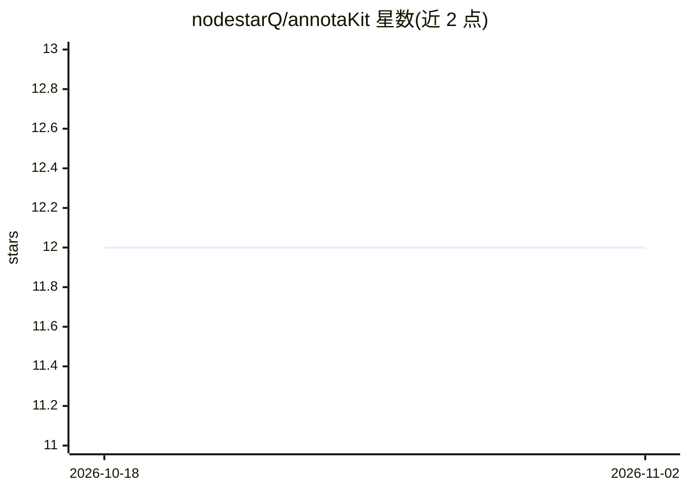

# nodestarQ/annotaKit

⭐ 12 · Svelte · MIT · 推送 2026-03-22 · [GitHub](https://github.com/nodestarQ/annotaKit) · [官网](https://annotakit.dev/) · 个人维护

**给 Web 开发者的 UI 标注组件：点选元素留注释，生成 agent 可用 markdown**

面向 Svelte/SvelteKit 开发者的 Svelte 5 组件：在应用内浮出工具栏，支持点击元素、选择文本、拖拽多选三种标注模式，添加注释后导出含 CSS 选择器、组件信息、无障碍属性与计算样式的结构化 markdown，可直接粘贴给 Claude、Cursor 等 AI 工具。提供 localStorage 持久化、三种输出详细度与 6 种高亮色。另提供 @annotakit/mcp 包，通过 MCP 服务器（9 个工具）让 AI agent 实时读取与回应标注。peer 依赖 svelte ^5.35.0。

## 筛选速览

| 维度 | 判定 | 备注 |
|---|---|---|
| AI 角色 | `ai-ecosystem` | LLM/agent 周边工具 |
| 许可风险 | `permissive` | MIT |
| 部署形态 | `library` | 以包/库形式分发 |
| 模型依赖 | — | README 未给出锁定关系 |
| 硬件要求 | — | 无带数字的原话,不猜 |
| 安装摩擦 | `low` | 无编译、无系统依赖或容器化 |
| 成熟度 | — | 结构信号不足 |

## 能力要点

- 三种标注模式：元素点击、文本选择、拖拽多选
- 导出含 CSS 选择器、组件链、无障碍属性、计算样式的 markdown（三种详细度）
- @annotakit/mcp 提供 9 个工具让 AI agent 实时读取/回应标注
- Svelte 组件检测（名称、文件、行号、组件链）

## 适用场景

- 在页面上圈出问题元素并附注释，直接交给 AI 编码工具修复
- 让 Claude Desktop/Code 通过 MCP 实时接收并处理我的 UI 标注
- 给前端团队沉淀待修复 UI 问题的结构化清单

## 场景标签

 · 领域:Web 开发工具/AI 编码辅助

## 证据(README 行号)

> L11: annotaKit is a Svelte component that lets you annotate UI elements and export structured markdown. Click elements, 
> L51: 4. **Export** - copy structured markdown to your clipboard or pipe it to an AI agent
> L118: annotaKit can connect to an MCP server so AI agents (Claude Desktop, Claude Code, etc.) can receive and respond to

## 星数曲线

2026-10-18 12 → 2026-11-02 12（+0）

---
*卡片 v1 · prompt 1.4 · 生成 2026-11-01 · 置信度 high · 依据 README sha `9d7950f528d1` · [字段定义](../../DATASET.md)*
