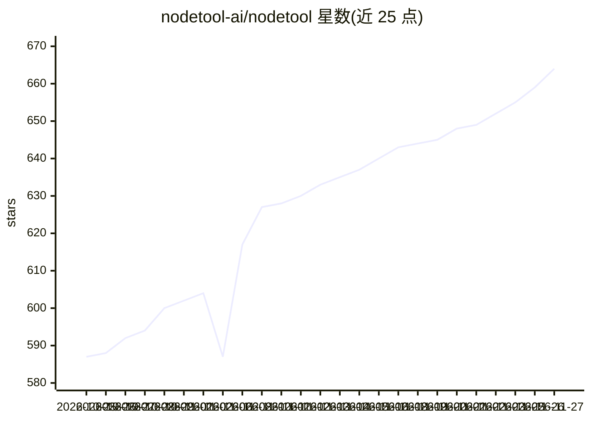

# nodetool-ai/nodetool

⭐ 664 · TypeScript · AGPL-3.0 · 推送 2026-11-26 · [GitHub](https://github.com/nodetool-ai/nodetool) · [官网](https://nodetool.ai/) · 组织维护 · 中文 README

**给视频/影像创作者的开源 AI 工作室：节点工作流驱动分镜与剪辑**

NodeTool Studio 是一个面向创意内容生产（短片、广告、动效、游戏）的开源工作台：一句话可由 agent 展开为剧本、分镜、片段并在时间线上剪出成片；底层是类型化端口连接的节点图，支持图片/视频/音频/文本多模态与 ComfyUI 工作流导入。模型来源三路：用 ChatGPT/Claude/Gemini 订阅登录运行、自带各 provider API key 按原价计费、或在本地硬件跑开放权重模型（Ollama/MLX/GGUF）。提供 macOS/Windows/Linux 桌面安装包与浏览器 alpha 版，AGPL-3.0 许可；本地模型有各自硬件要求。

## 筛选速览

| 维度 | 判定 | 备注 |
|---|---|---|
| AI 角色 | `ai-native` | 本体是模型或模型工具 |
| 许可风险 | `viral` | AGPL-3.0 |
| 部署形态 | `library` | 以包/库形式分发 |
| 模型依赖 | local-ok | 支持本地模型 |
| 硬件要求 | — | 无带数字的原话,不猜 |
| 安装摩擦 | `low` | 无编译、无系统依赖或容器化 |
| 成熟度 | `idea` | |

## 能力要点

- agent 将一句话目标展开为步骤 DAG，编辑器以工具形式暴露给 agent，并通过 MCP 供 Claude Desktop/Codex 等驱动
- 七个编辑器共享一个项目：分镜、脚本、时间线、草图、3D、游戏与节点图
- 支持自有订阅登录、provider key 或本地开放权重（Ollama/MLX/GGUF）三种模型接入方式
- 工作流绑定时间线片段，输入变更后自动标记过期以便局部重生成

## 适用场景

- 用一段文字生成分镜、配音与剪辑并导出成片
- 把跑通的节点工作流复用到下一条视频或多个广告变体
- 在本地硬件上用开放权重模型生成图像和视频
- 通过 MCP 让外部 agent 操作工作室工具链

## 场景标签

`图像生成` `视频生成` `图像视频处理` `多模态` · 领域:内容生成

## 证据(README 行号)

> L13: **The open-source AI studio you actually control.** Storyboard, generate, and
> L74: Made it once? Run it again. Underneath every project is a node graph. Save the
> L256: |**Every major provider**|OpenAI, Anthropic, Gemini, FAL, KIE, Replicate, ElevenLabs, HuggingFace, plus generated 

## 星数曲线

2026-10-25 587 → 2026-11-27 664（+77）

---
*卡片 v1 · prompt 1.4 · 生成 2026-11-26 · 置信度 mid · 依据 README sha `95d40dbe4fdc` · [字段定义](../../DATASET.md)*
