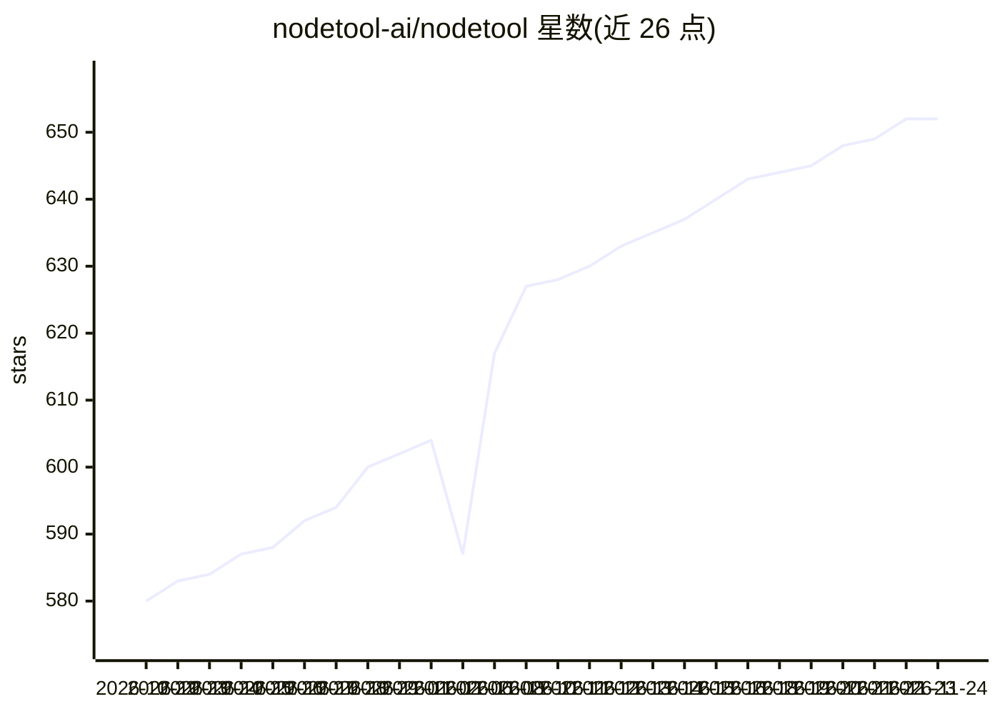

# nodetool-ai/nodetool

⭐ 652 · TypeScript · AGPL-3.0 · 推送 2026-11-22 · [GitHub](https://github.com/nodetool-ai/nodetool) · [官网](https://nodetool.ai/) · 组织维护 · 中文 README

**开源 AI 影片工作室：一句话到分镜、生成与剪辑成片**

NodeTool 是面向 macOS、Windows 和 Linux 的桌面创作工作室，围绕 agent 与节点工作流组织：输入一句话后 agent 生成节拍表、角色实体、逐镜头分镜静帧，经用户逐帧批准后生成视频并在时间线上剪集成片。提供分镜、剧本配音、时间线、图层绘画、3D、游戏和节点图七个编辑器，各编辑器的操作以工具形式暴露给 agent，并通过 MCP 供外部 agent 驱动。模型经自有 provider key 计费，或以订阅计划运行，或本地运行开放权重模型；Cloud 版处于 alpha 阶段。许可证为 AGPL-3.0。

## 筛选速览

| 维度 | 判定 | 备注 |
|---|---|---|
| AI 角色 | `ai-native` | 本体是模型或模型工具 |
| 许可风险 | `viral` | AGPL-3.0 |
| 部署形态 | `library` | 以包/库形式分发 |
| 模型依赖 | local-ok | 支持本地模型 |
| 硬件要求 | — | 无带数字的原话,不猜 |
| 安装摩擦 | `low` | 无编译、无系统依赖或容器化 |
| 成熟度 | `idea` | |

## 能力要点

- 一句话到节拍表、分镜静帧、视频片段与成片的项目化流程
- agent 可操作全部编辑器，工具通过 MCP 暴露给 Claude Desktop/Claude Code/Codex
- 七类编辑器共享一个项目：分镜、剧本、时间线、图层、3D、游戏、节点图
- 支持自有 provider key、订阅计划或本地开放权重（Ollama/MLX/GGUF）运行

## 适用场景

- 从一句话生成短片并用时间线逐镜头剪辑
- 把可复用的生成流程保存为节点工作流批量再跑
- 通过 MCP 让外部 agent 代为搭建和运行工作流
- 自托管部署并租用 GPU worker 扩展生成任务

## 场景标签

`工作流自动化` `图像生成` `视频生成` `图像视频处理` · 领域:效率与自动化

## 证据(README 行号)

> L11: **Open-source AI film studio · agent + node workflows**
> L13: **Direct AI films, shot by shot.** Start with one sentence. The agent writes
> L66: Underneath, a planner turns an objective into a DAG of steps, executors walk it

## 星数曲线

2026-10-22 580 → 2026-11-24 652（+72）

---
*卡片 v1 · prompt 1.4 · 生成 2026-11-24 · 置信度 high · 依据 README sha `41b7ca3d6dca` · [字段定义](../../DATASET.md)*
