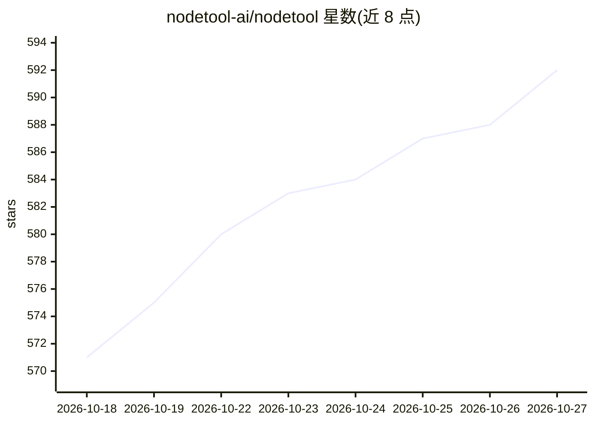

# nodetool-ai/nodetool

⭐ 592 · TypeScript · AGPL-3.0 · 推送 2026-10-26 · [GitHub](https://github.com/nodetool-ai/nodetool) · [官网](https://nodetool.ai/) · 组织维护

**Agent 驱动的创意工作台：用对话与节点图产出图像/视频/音频**

面向创作者的桌面端（macOS/Windows/Linux）创意工作台：以 agent 驱动七个编辑器（分镜/脚本配音/时间线/草图/3D/游戏/节点图），从一句简报生成分镜、静帧、镜头剪辑与成片，支持逐镜头修改与 MP4 导出。模型接入采用自带 key 直连云厂商（OpenAI/Anthropic/Gemini/FAL/KIE/Replicate 等），也支持 Ollama、MLX、GGUF 本地权重；agent 层由 planner 生成 DAG、并行执行并输出 OpenTelemetry span。工具经 MCP 暴露给 Claude Code/Codex 等外部 agent；NodeTool Cloud 处于 alpha。AGPL-3.0 开源。

## 筛选速览

| 维度 | 判定 | 备注 |
|---|---|---|
| AI 角色 | `ai-native` | 本体是模型或模型工具 |
| 许可风险 | `viral` | AGPL-3.0 |
| 部署形态 | `library` | 以包/库形式分发 |
| 模型依赖 | local-ok | 支持本地模型 |
| 硬件要求 | — | 无带数字的原话,不猜 |
| 安装摩擦 | `low` | 无编译、无系统依赖或容器化 |
| 成熟度 | `idea` | |

## 能力要点

- Agent 驱动七个编辑器：分镜、脚本配音、时间线、草图、3D、游戏、节点图
- 自有 key 直连各云厂商，也支持 Ollama/MLX/GGUF 本地模型
- 工具经 MCP 暴露，可由 Claude Code、Codex 等外部 agent 调用
- 工作流可发布为 Mini Apps，支持 Docker 自托管

## 适用场景

- 从一句简报生成分镜、静帧再到成片的短片制作
- 在节点图中编排跨图像/视频/音频/文本的多模态工作流
- 让 Claude Code 或 Codex 通过 MCP 驱动创意工作流
- 把工作流包装成带界面的 Mini App 交给同事使用

## 场景标签

`图像生成` `视频生成` `工作流自动化` · 领域:效率与自动化

## 证据(README 行号)

> L12: Create images, video, audio, and text with agents that work alongside you.
> L33: - Agents drive the real editors. They wire the graph and run it. You take the
> L240: |**Every major provider**|OpenAI, Anthropic, Gemini, FAL, KIE, Replicate, ElevenLabs, HuggingFace, plus one node f

## 星数曲线

2026-10-18 571 → 2026-10-27 592（+21）

---
*卡片 v1 · prompt 1.4 · 生成 2026-10-21 · 置信度 high · 依据 README sha `40eca9fefac4` · [字段定义](../../DATASET.md)*
