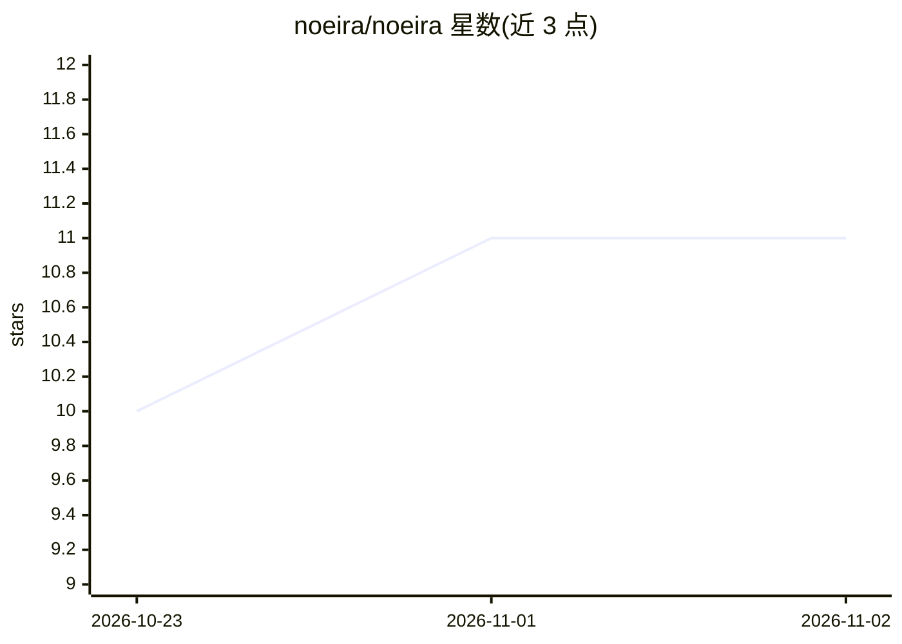

# noeira/noeira

⭐ 11 · Mojo · MIT · 推送 2026-10-30 · [GitHub](https://github.com/noeira/noeira) · [官网](https://noeira.ai) · 组织维护

**纯 Mojo 实现的端到端物理 AI 全栈：仿真、学习到机器人部署**

用 Mojo 单一语言构建完整机器人学习闭环：MuJoCo 对齐的 3D 物理引擎（MJCF 加载、多种求解器、CPU 与批式 GPU）、350+ 环境与任务、强化学习（DQN/PPO/SAC 等）、世界模型、模仿学习与 VLA 策略、机器人舵机总线与相机驱动，以及部署到机器人本体计算机的运行时（ACT 在 Jetson Orin NX 上 30 Hz 闭环）。通过 pixi 安装，支持 osx-arm64(Metal)、linux-64(CUDA 12) 与 linux-aarch64。项目自述为 beta，各模块成熟度不一。

## 筛选速览

| 维度 | 判定 | 备注 |
|---|---|---|
| AI 角色 | `ai-native` | 本体是模型或模型工具 |
| 许可风险 | `permissive` | MIT |
| 部署形态 | `None` |  |
| 模型依赖 | — | README 未给出锁定关系 |
| 硬件要求 | — | 无带数字的原话,不猜 |
| 安装摩擦 | `medium` | 含编译或系统依赖之一 |
| 成熟度 | `idea` | |

## 能力要点

- MuJoCo 对齐的 3D 物理引擎（MJCF 加载、PGS/Newton/CG 求解器）
- 350+ 环境与任务，覆盖 DQN/PPO/SAC、DreamerV3、ACT、SmolVLA 等算法
- SO-101 机械臂驱动、LeRobot v3 格式数据记录与边缘部署
- 训练与部署同为 Mojo 代码，pixi 安装含 SDL3 无需系统级安装

## 适用场景

- 在单一语言栈中训练强化学习策略并部署到真实机器人
- 使用 MuJoCo 风格环境做运动与操作任务研究
- 在 Jetson Orin 等边缘设备上运行 VLA/模仿学习策略

## 场景标签

`强化学习` · 领域:训练与推理

## 证据(README 行号)

> L4:  An end-to-end Physical AI stack in Mojo: physics, learning, perception and deployment, from simulator to robot.
> L12: robot's own computer. The policy that trains on a GPU box is the same Mojo code

## 星数曲线

2026-10-23 10 → 2026-11-02 11（+1）

---
*卡片 v1 · prompt 1.4 · 生成 2026-11-01 · 置信度 high · 依据 README sha `2c93cc0f47f0` · [字段定义](../../DATASET.md)*
