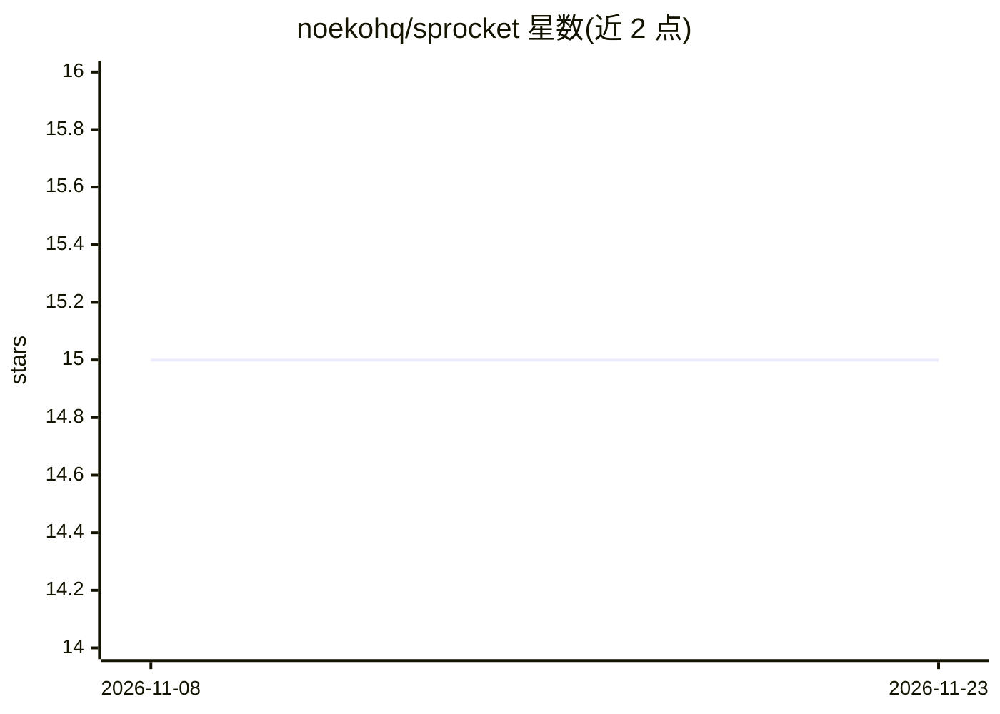

# noekohq/sprocket

⭐ 15 · Python · NOASSERTION · 推送 2026-11-06 · [GitHub](https://github.com/noekohq/sprocket) · 个人维护

**由 LLM 驱动、可在本机执行任务的命令行智能体**

Simon 是一个基于 LLM 的极简命令行智能体，以感知→推理→行动的循环运行：感知阶段合并环境分析、会话内任务/记事本与记忆召回，推理阶段调用模型 API，行动阶段执行模型输出的工具调用（文件、搜索、Web、Python、shell 等库）。支持 OpenAI、Anthropic、Google Gemini 三类提供商适配器，内置可选的 SQLite 记忆与 Markdown 记忆目录，提供角色切换（助手/开发者/研究者）。通过 git clone 与 uv 安装运行，宿主 shell 命令需逐次审批；README 声明项目仍在开发中，且智能体可在用户机器上执行命令。

## 筛选速览

| 维度 | 判定 | 备注 |
|---|---|---|
| AI 角色 | `ai-native` | 本体是模型或模型工具 |
| 许可风险 | `none` | NOASSERTION |
| 部署形态 | `library` | 以包/库形式分发 |
| 模型依赖 | — | README 未给出锁定关系 |
| 硬件要求 | — | 无带数字的原话,不猜 |
| 安装摩擦 | `low` | 无编译、无系统依赖或容器化 |
| 成熟度 | `idea` | |

## 能力要点

- 感知→推理→行动循环的智能体架构，工具覆盖 fs/search/web/python/shell
- OpenAI、Anthropic、Google Gemini 提供商适配器，启动时选定
- 内置 SQLite 记忆与可编辑 Markdown 记忆目录，嵌入适配器独立于对话模型
- 角色系统（Helpful Assistant / Developer / Researcher）按角色分配工具

## 适用场景

- 在终端让智能体执行文件、搜索、Web 检索、Python 与审批制 shell 任务
- 以 Developer 角色做项目检查、编辑与验证
- 为智能体配置跨会话持久记忆

## 场景标签

`AI 助手` `编码 Agent` · 领域:编码与开发

## 证据(README 行号)

> L13: This is an attempt to make a bare-bones, very simple agent based on LLMs and other technologies.
> L27: The perception stage combines environmental analysis, session-local workbench views (tasks and a notepad), and memo
> L106: That's it! You should see the agent start up, and you can ask it to do things using it's tools.

## 星数曲线

2026-11-08 15 → 2026-11-23 15（+0）

---
*卡片 v1 · prompt 1.4 · 生成 2026-11-18 · 置信度 mid · 依据 README sha `818599ba9f64` · [字段定义](../../DATASET.md)*
