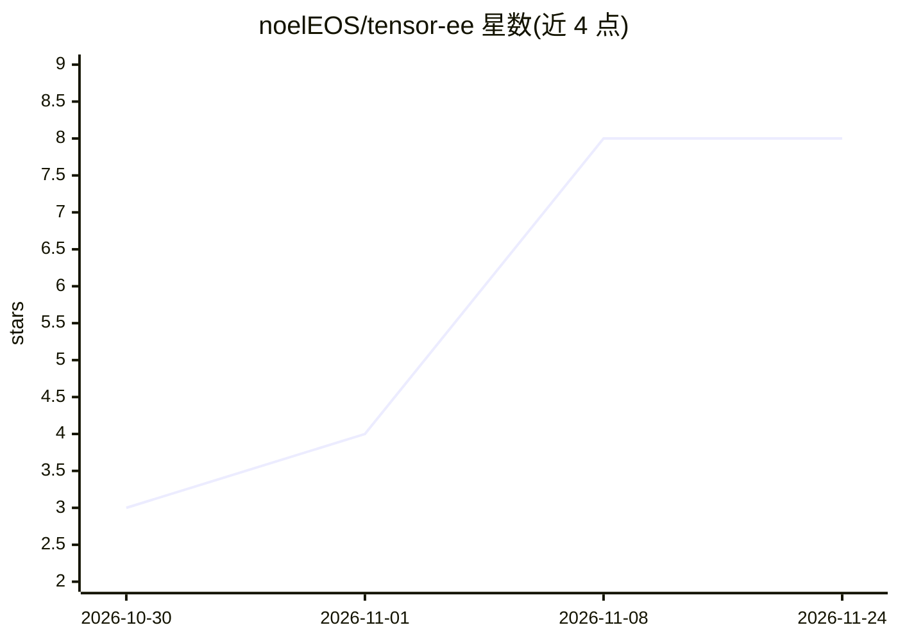

# noelEOS/tensor-ee

⭐ 8 · Python · MIT · 推送 2026-11-22 · [GitHub](https://github.com/noelEOS/tensor-ee) · 个人维护

**在 Google Earth Engine 内原生运行 PyTorch 模型的转换库**

将受支持的 PyTorch 神经网络转换为 Earth Engine 图像与数组操作，使推理无需部署模型服务端点即可在 Earth Engine 内执行；权重以嵌入常量或 EE 表资产读取，大模型可分阶段运行并保存中间特征为 EE 资产。支持将影像送入 Vertex AI 端点作为对照路径。支持 SegWater U-Net、Swin-T/UPerNet、Prithvi Sen1Floods11、SegFormer/DPT 等模型转换，90 个积木块可组合模型。README 声明为实验性质、支持范围受限，仅块目录内设置有验证证据；使用 Earth Engine 计算与存储，受其费用与配额约束。

## 筛选速览

| 维度 | 判定 | 备注 |
|---|---|---|
| AI 角色 | `ai-ecosystem` | LLM/agent 周边工具 |
| 许可风险 | `permissive` | MIT |
| 部署形态 | `library` | 以包/库形式分发 |
| 模型依赖 | — | README 未给出锁定关系 |
| 硬件要求 | — | 无带数字的原话,不猜 |
| 安装摩擦 | `low` | 无编译、无系统依赖或容器化 |
| 成熟度 | `idea` | |

## 能力要点

- 模型推理表达为 Earth Engine 图像/数组操作，无需模型服务端点
- 分阶段推理：中间特征保存为 EE 资产，Prithvi 合并阶段将导出从 33 降到 16
- 包含 90 个积木块（25 raster + 65 window）可组合模型
- 不支持的算子直接拒绝而非近似

## 适用场景

- 在 Earth Engine 内对 Sentinel-1/2 影像直接运行训练好的分割模型
- 将自有 CNN checkpoint 转换为 EE 计算图
- 对大模型分阶段执行并保存中间特征避免重算

## 场景标签

`目标检测` · 领域:感知与多模态

## 证据(README 行号)

> L7: **Run supported PyTorch models inside Google Earth Engine, without deploying a
> L8: model-serving endpoint.** TensorEE expresses neural-network inference as Earth Engine
> L15: Python builds the computation graph; Earth Engine evaluates the forward pass. Weights

## 星数曲线

2026-10-30 3 → 2026-11-24 8（+5）

---
*卡片 v1 · prompt 1.4 · 生成 2026-11-20 · 置信度 high · 依据 README sha `f3f8e034328b` · [字段定义](../../DATASET.md)*
