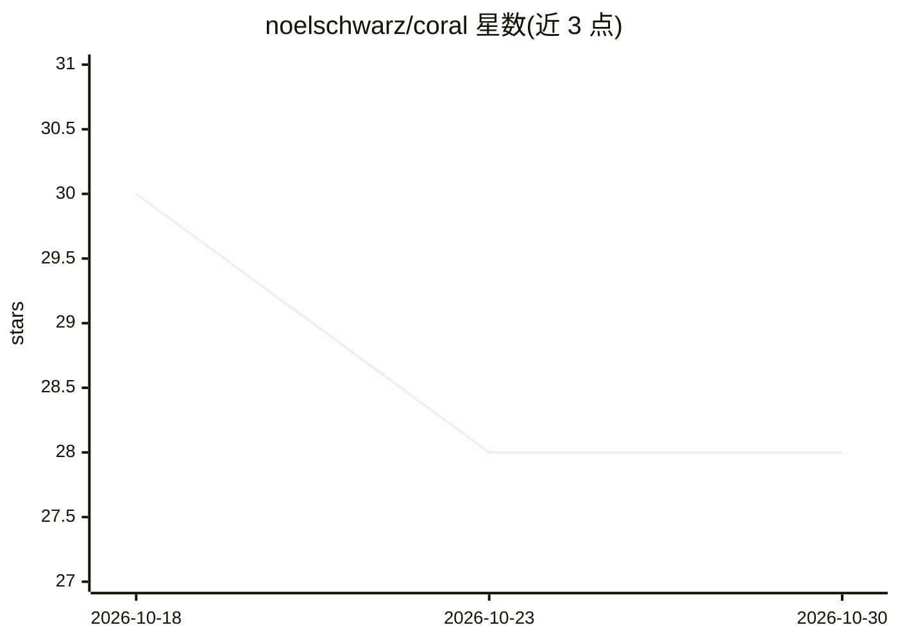

# noelschwarz/coral

⭐ 28 · Python · Apache-2.0 · 推送 2026-10-19 · [GitHub](https://github.com/noelschwarz/coral) · [官网](https://basematter.dev) · 个人维护

**本地优先的会话桥：让 AI agent 按站点/按动作借用已认证浏览器会话**

由 Python 守护进程 + CLI、Chrome 扩展与 MCP 服务器组成的本地优先会话桥。用户在真实 Chrome 中完成登录（含 2FA/验证码）后，扩展捕获会话并存入口令加密的 SQLCipher 保险库；agent 请求时，Coral 启动恢复该会话的隔离 Chromium 并交出 CDP URL，agent 全程不接触密码。每个站点有 YAML 策略（allowed/denied 路径、限流、人工审批），默认拒绝并带 6 个站点行为包。支持 Claude Desktop/Cursor/browser-use 等 MCP 客户端接入。项目自述为 alpha、未经外部安全审计，仅支持 macOS/Linux，Windows 未支持。

## 筛选速览

| 维度 | 判定 | 备注 |
|---|---|---|
| AI 角色 | `ai-ecosystem` | LLM/agent 周边工具 |
| 许可风险 | `permissive` | Apache-2.0 |
| 部署形态 | `desktop` | 安装包/桌面程序 |
| 模型依赖 | — | README 未给出锁定关系 |
| 硬件要求 | — | 无带数字的原话,不猜 |
| 安装摩擦 | `low` | 无编译、无系统依赖或容器化 |
| 成熟度 | `idea` | |

## 能力要点

- 已认证会话存入口令加密保险库，agent 仅获 CDP URL，不接触密码
- 按站点 YAML 策略引擎：allowed/denied 路径、限流、审批阈值，默认拒绝
- MCP 服务器 + Python SDK 嵌入两种接入方式，每会话独立沙箱 Chromium
- 提供 coral install-service 常驻服务与 OS 钥匙串存口令

## 适用场景

- 让浏览器自动化 agent 复用我已登录的 GitHub/Gmail 等会话而无需交出密码
- 在 Claude Desktop/Cursor 中通过 MCP 打开和关闭受策略约束的认证浏览器
- 对 agent 的站点操作按白名单策略做审批与审计

## 场景标签

`浏览器自动化` · 领域:效率与自动化

## 证据(README 行号)

> L28: - **Python daemon + CLI** (this repo) — vault, HTTP API, MCP server,
> L33: - **MCP** — any MCP-speaking agent (Claude Desktop, Cursor, Claude Code,
> L42: The dominant use case is **embedding Coral as a session manager inside

## 星数曲线

2026-10-18 30 → 2026-10-30 28（-2）

---
*卡片 v1 · prompt 1.4 · 生成 2026-10-26 · 置信度 high · 依据 README sha `b3d3fecdf210` · [字段定义](../../DATASET.md)*
