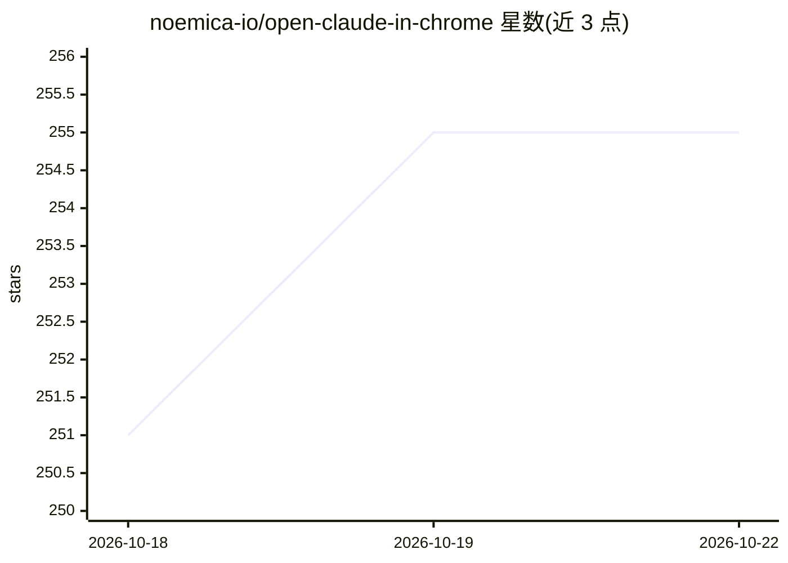

# noemica-io/open-claude-in-chrome

⭐ 255 · HTML · NOASSERTION · 推送 2026-09-22 · [GitHub](https://github.com/noemica-io/open-claude-in-chrome) · 组织维护

**开源版 Claude 浏览器扩展：无域名封锁的 Claude Code 浏览器自动化**

对 Anthropic Claude in Chrome 扩展的净室重实现：移除 58 个域名封锁，支持任意 Chromium 浏览器，提供相同的 21 个 MCP 浏览器工具。架构为三层：Manifest V3 扩展（CDP 自动化）+ Node.js MCP 服务器 + Native Messaging 桥。hybrid 变体额外提供 execute_code 沙箱（Cloudflare Worker/workerd sidecar 运行 LLM 生成代码）与模仿学习录制器（记录操作与语音解说，需 OpenAI key 转录）。面向已使用 Claude Code 的开发者，安装需 Node.js 18+、Chromium 浏览器与 Claude Code v2.1.80+。

## 筛选速览

| 维度 | 判定 | 备注 |
|---|---|---|
| AI 角色 | `ai-ecosystem` | LLM/agent 周边工具 |
| 许可风险 | `none` | NOASSERTION |
| 部署形态 | `library` | 以包/库形式分发 |
| 模型依赖 | — | README 未给出锁定关系 |
| 硬件要求 | — | 无带数字的原话,不猜 |
| 安装摩擦 | `low` | 无编译、无系统依赖或容器化 |
| 成熟度 | `idea` | |

## 能力要点

- 无域名封锁、支持任意 Chromium 浏览器（Chrome/Edge/Brave/Arc 等）
- 21 个 MCP 浏览器工具，与官方扩展相同的工具集
- execute_code 在 Cloudflare Worker V8 沙箱中运行 LLM 生成的 JS 代码
- 模仿学习录制器：双轨记录操作与语音解说，交给 Claude Code 会话执行

## 适用场景

- 让 Claude Code 自动化操作官方扩展封锁的网站（银行/社交/约会等）
- 用单个 execute_code 调用完成多步浏览器流程
- 示范操作一次后让 Claude 学习并复现同类浏览器任务
- 在 Brave/Arc/Opera 等非 Chrome/Edge 浏览器上使用浏览器自动化

## 场景标签

 · 领域:AI Agent/浏览器自动化

## 证据(README 行号)

> L25: The official Claude in Chrome extension gives Claude Code full browser automation — as long as you stay within Anth
> L93: Claude Code <--stdio MCP--> mcp-server.js <--TCP--> native-host.js <--native messaging--> Extension <--> Browser
> L107: 2. **MCP Server** — Node.js process started by Claude Code, exposes tools via MCP

## 星数曲线

2026-10-18 251 → 2026-10-22 255（+4）

---
*卡片 v1 · prompt 1.4 · 生成 2026-10-22 · 置信度 high · 依据 README sha `6d791c2a29a3` · [字段定义](../../DATASET.md)*
