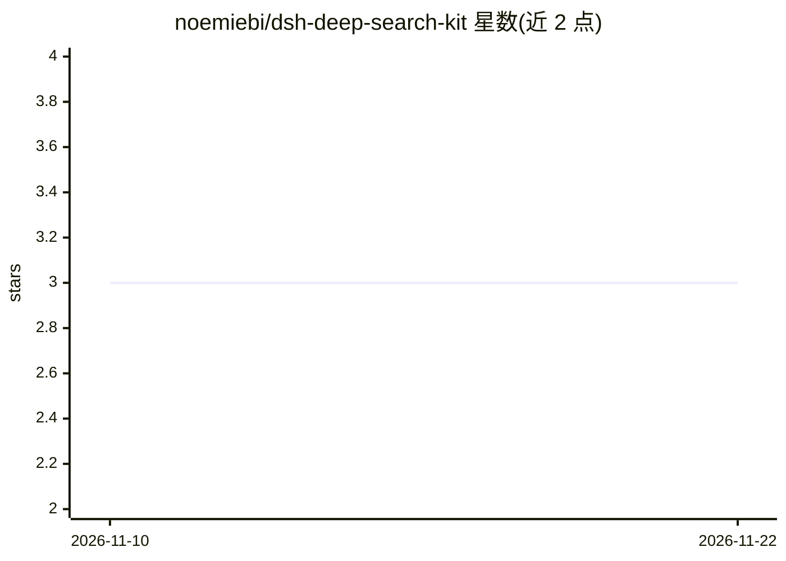

# noemiebi/dsh-deep-search-kit

⭐ 3 · Python · MIT · 推送 2026-11-07 · [GitHub](https://github.com/noemiebi/dsh-deep-search-kit) · 个人维护

**给 DSH agent 加深度搜索模式并输出韩文 PDF 报告的工具包**

面向 DSH（DeepSeek agent harness）Web 配置的补丁与工具集合：通过 profile 补丁把内置 Standard 模式改造为带 19 条研究规则的 Deep search 模式（搜索/读取次数上限、只引用有出处的数字、facts.md 事实文件、长文件分块写入）；附带两个辅助工具——fetch_doc.sh 读取 PDF/HWPX/Excel 与慢服务器文档，report_kit 经无头 Chrome 生成带目录页码与数字核对检查的 A4 韩文 PDF 报告。macOS 专用，经 DSH 0.2.1-rc.2 测试，规则与回答均为韩语。

## 筛选速览

| 维度 | 判定 | 备注 |
|---|---|---|
| AI 角色 | `ai-ecosystem` | LLM/agent 周边工具 |
| 许可风险 | `permissive` | MIT |
| 部署形态 | `library` | 以包/库形式分发 |
| 模型依赖 | — | README 未给出锁定关系 |
| 硬件要求 | — | 无带数字的原话,不猜 |
| 安装摩擦 | `low` | 无编译、无系统依赖或容器化 |
| 成熟度 | `idea` | |

## 能力要点

- 19 条韩文研究规则补丁：来源优先级、搜索/读取次数上限、facts.md 防压缩丢失
- fetch_doc.sh 支持 PDF/HWPX/XLSX/XLS 转文本，带重试与关键词上下文截取
- report_kit 生成 A4 韩文 PDF，自动目录页码并做数字-vs-facts 检查
- matplotlibrc 保证图表中韩/日/中文字体不缺字

## 适用场景

- 让 DSH agent 做带出处的深度网络调研
- 把政府/机构网站上的 PDF、公文附件读取进调研流程
- 把调研结果排版成带目录页码的韩文报告 PDF

## 场景标签

`科研工具` `文档解析` · 领域:知识与检索

## 证据(README 行号)

> L3: **English summary.** A small kit for the Web profile of DSH (DeepSeek's agent harness, `@deepseek-ai/dsh`). It turns
> L5: DSH Web 프로필의 **Deep search 모드**용 설정 묶음입니다.
> L67: - DSH (`@deepseek-ai/dsh`, Web 프로필). 모델·공급자는 DSH 기본 DeepSeek 공급자를 그대로 씁니다. 다른 공급자를 쓰려면 각자 프로필에서 설정합니다(이 키트는 공급자 설정을

## 星数曲线

2026-11-10 3 → 2026-11-22 3（+0）

---
*卡片 v1 · prompt 1.4 · 生成 2026-11-21 · 置信度 mid · 依据 README sha `c3c60f497fac` · [字段定义](../../DATASET.md)*
