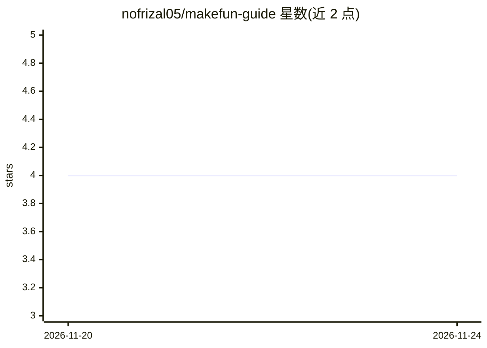

# nofrizal05/makefun-guide

⭐ 4 · NOASSERTION · 推送 2026-11-18 · [GitHub](https://github.com/nofrizal05/makefun-guide) · [官网](https://make.fun/bounty/bring-the-humans-02) · 个人维护

**面向新人的 make.fun 赏金平台入门指南，由 AI agent 撰写**

本文档是一份介绍 make.fun 赏金平台的教程：该平台由企业发布赏金任务，参与者用 AI 编码 agent 构建作品，按公开规则评分，奖金以 USDC 托管在 Solana 上发放。指南说明账号注册、Solana 钱包绑定、agent 授权接入、本地 check 校验、提交与领取奖金的完整流程，以及推荐返佣机制、transcript 存证要求与防作弊检查。本仓库本身即是该平台“Bring the humans again”指南赏金任务的参赛作品，由 AI agent 生成。

## 筛选速览

| 维度 | 判定 | 备注 |
|---|---|---|
| AI 角色 | `ai-knowledge` | 知识聚合/清单类 |
| 许可风险 | `none` | NOASSERTION |
| 部署形态 | `None` |  |
| 模型依赖 | — | README 未给出锁定关系 |
| 硬件要求 | — | 无带数字的原话,不猜 |
| 安装摩擦 | `low` | 无编译、无系统依赖或容器化 |
| 成熟度 | `idea` | |

## 能力要点

- 覆盖注册、钱包绑定、agent 授权（makefun login 审批流）到提交领奖的全流程说明
- 列出条目被拒的常见原因：transcript 检查、30% 自著行数门槛、文件命名与大小限制
- 介绍推荐计划：首触归因 60 天、推荐人获被推荐者奖金 10%（90 天内）
- 提供 kit 的本地 check 命令用于提交前自检

## 适用场景

- 作为新人了解 make.fun 赏金平台的运作方式
- 第一次参赛前熟悉提交流程与防作弊规则
- 了解 AI agent 赏金任务的评分与奖金托管机制

## 场景标签

`教程课程` · 领域:学习与行业

## 证据(README 行号)

> L9: This guide explains, in plain language, what make.fun is, how it works, how to join, and how to actually win somethi
> L23: make.fun is a marketplace for software bounties, built around AI agents.

## 星数曲线

2026-11-20 4 → 2026-11-24 4（+0）

---
*卡片 v1 · prompt 1.4 · 生成 2026-11-21 · 置信度 high · 依据 README sha `fac697ffc477` · [字段定义](../../DATASET.md)*
