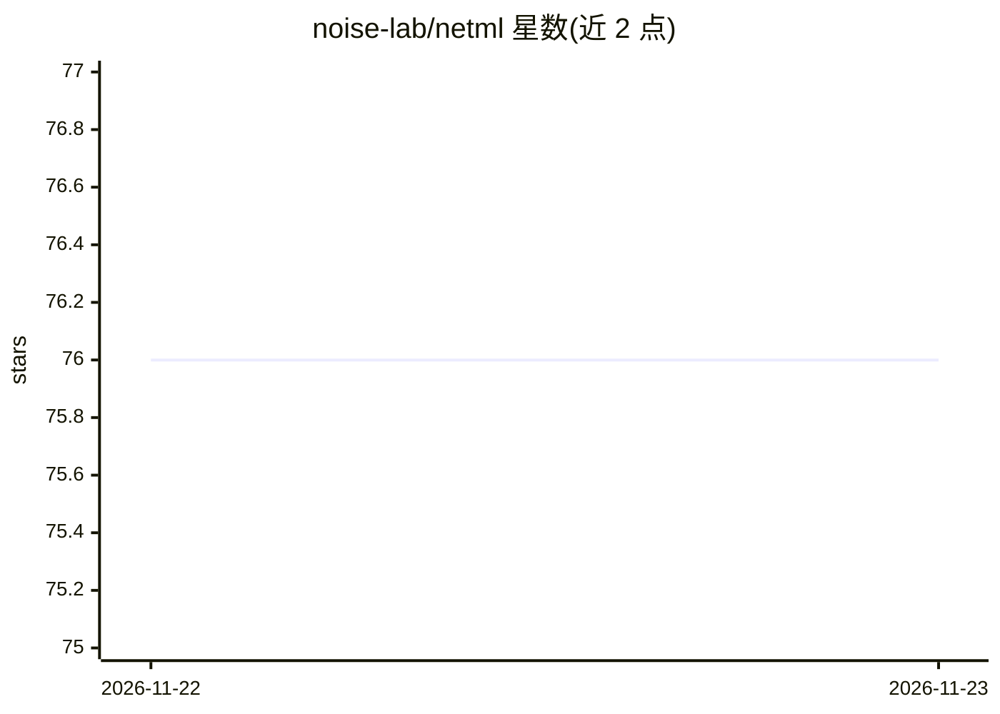

# noise-lab/netml

⭐ 76 · Python · Apache-2.0 · 推送 2026-11-21 · [GitHub](https://github.com/noise-lab/netml) · 组织维护

**面向网络流量分析的异常检测 Python 工具与库**

用 Python 实现的网络异常检测工具与库，含两个主子模块：pparser 基于 Scapy 解析 pcap 并生成流级特征（IAT/STATS/SIZE/采样序列及 FFT 变体），支持转 pandas DataFrame；ndm 通过 OCSVM、KDE、孤立森林、自编码器等模型检测异常流量。提供 CLI（netml learn/classify/extract）与 Python API，支持 YAML/JSON 自定义超参数与特征宽度对齐，示例使用 UNB 入侵检测数据集，附 arXiv 论文引用。

## 筛选速览

| 维度 | 判定 | 备注 |
|---|---|---|
| AI 角色 | `ai-native` | 本体是模型或模型工具 |
| 许可风险 | `permissive` | Apache-2.0 |
| 部署形态 | `library` | 以包/库形式分发 |
| 模型依赖 | — | README 未给出锁定关系 |
| 硬件要求 | — | 无带数字的原话,不猜 |
| 安装摩擦 | `low` | 无编译、无系统依赖或容器化 |
| 成熟度 | — | 结构信号不足 |

## 能力要点

- 基于 Scapy 的 pcap 解析与多种流特征提取（IAT/STATS/SIZE/SAMP_NUM/SAMP_SIZE 及 FFT 变体）
- 支持 OCSVM、KDE、孤立森林、自编码器等异常检测算法
- CLI 与 Python API 双入口：learn 训练、classify 检测、extract 仅提特征
- 通过 --feature-dim 与 dim 机制对齐不同捕获的特征宽度

## 适用场景

- 对 pcap 流量做异常/入侵检测建模与分类
- 将网络流量转换为流级特征矩阵供后续机器学习使用
- 复现论文中的网络流量表示对比实验

## 场景标签

`网络安全` · 领域:学习与行业

## 证据(README 行号)

> L3: `netml` is a network anomaly detection tool & library written in Python.
> L12: Detect novelties / anomalies, via different models, such as OCSVM.
> L130: * `--algorithm`: selection of model-training algorithms, such as One-Class Support Vector Machine (OCSVM), Kernel 

## 星数曲线

2026-11-22 76 → 2026-11-23 76（+0）

---
*卡片 v1 · prompt 1.4 · 生成 2026-11-22 · 置信度 high · 依据 README sha `0132a9279a4a` · [字段定义](../../DATASET.md)*
