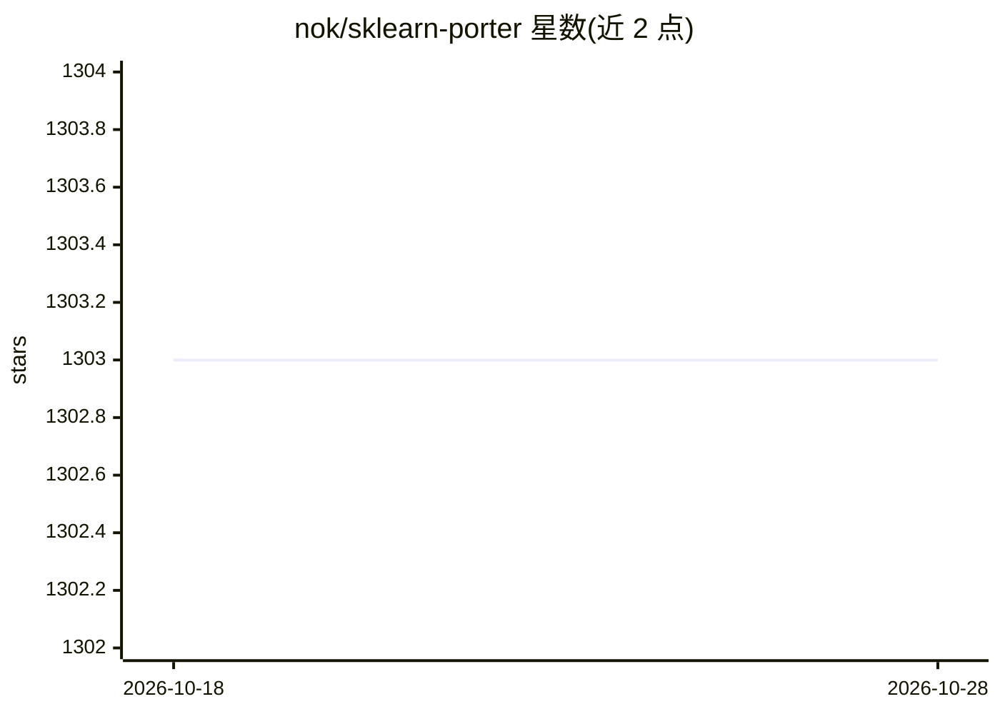

# nok/sklearn-porter

⭐ 1,303 · Python · BSD-3-Clause · 推送 2026-10-27 · [GitHub](https://github.com/nok/sklearn-porter) · 个人维护

**将训练好的 scikit-learn 模型转译为 C/Java/JS 等语言代码**

Python 转译工具：读取已训练的 scikit-learn 估计器（含 50+ 分类器、回归器与异常检测器），生成 C、C#、Go、Java、JavaScript、PHP、Ruby 代码，使模型能在无 Python 环境或资源受限处（嵌入式、浏览器、既有应用）做预测，且预测结果与原模型一致。支持三种模板（attached/exported/combined）管理模型数据，提供函数式与面向对象 API 及 porter 命令行；要求 Python 3.11+ 与 scikit-learn 1.8+，部分步骤需目标语言编译器/解释器。文档列出管道、稀疏数据等限制。

## 筛选速览

| 维度 | 判定 | 备注 |
|---|---|---|
| AI 角色 | `ai-ecosystem` | LLM/agent 周边工具 |
| 许可风险 | `permissive` | BSD-3-Clause |
| 部署形态 | `library` | 以包/库形式分发 |
| 模型依赖 | — | README 未给出锁定关系 |
| 硬件要求 | — | 无带数字的原话,不猜 |
| 安装摩擦 | `low` | 无编译、无系统依赖或容器化 |
| 成熟度 | — | 结构信号不足 |

## 能力要点

- 支持 50+ 种 scikit-learn 估计器（分类/回归/异常检测）
- 转译到 C、C#、Go、Java、JavaScript、PHP、Ruby 七种语言
- 三种模板：模型数据嵌入代码 / JSON 导出 / 编入逻辑
- 提供 porter CLI，可配合 terser 等工具压缩输出

## 适用场景

- 把训练好的模型部署到无 Python 的嵌入式或浏览器环境
- 在既有 Java/C# 应用中复用 scikit-learn 模型
- 通过命令行批量转译 joblib 持久化的模型文件

## 场景标签

 · 领域:机器学习工具链

## 证据(README 行号)

> L8: Transpile trained scikit-learn estimators to **C**, **C#**, **Go**, **Java**, **JavaScript**, **PHP** and **Ruby**.
> L10: Use the generated code to make predictions where Python isn't available or is too heavy, e.g. on embedded systems, 

## 星数曲线

2026-10-18 1,303 → 2026-10-28 1,303（+0）

---
*卡片 v1 · prompt 1.4 · 生成 2026-10-21 · 置信度 mid · 依据 README sha `a35b99a65006` · [字段定义](../../DATASET.md)*
