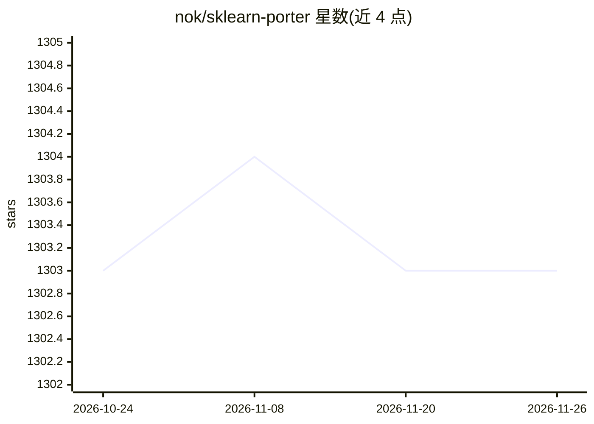

# nok/sklearn-porter

⭐ 1,303 · Python · BSD-3-Clause · 推送 2026-11-19 · [GitHub](https://github.com/nok/sklearn-porter) · 个人维护

**将训练好的 scikit-learn 模型转译为 7 种语言的代码库**

sklearn-porter 读取已训练的 scikit-learn 估计器与变换器，将其转译（transpile）为 C、C#、Go、Java、JavaScript、PHP、Ruby 七种语言的源代码，转译后的模型与原模型给出相同预测。适用于 Python 不可用或过重的运行环境，如嵌入式系统、浏览器或既有应用。支持 21 个分类器、21 个回归器、2 个异常检测器及 32 个变换器/预处理器，提供 Python API（port/save/test）与 CLI 命令 porter；make()/test() 需要对应语言的编译器或解释器。要求 Python 3.11+ 与 scikit-learn 1.8+，BSD 3-Clause 许可。

## 筛选速览

| 维度 | 判定 | 备注 |
|---|---|---|
| AI 角色 | `ai-native` | 本体是模型或模型工具 |
| 许可风险 | `permissive` | BSD-3-Clause |
| 部署形态 | `library` | 以包/库形式分发 |
| 模型依赖 | — | README 未给出锁定关系 |
| 硬件要求 | — | 无带数字的原话,不猜 |
| 安装摩擦 | `high` | 编译与系统依赖俱全 |
| 成熟度 | — | 结构信号不足 |

## 能力要点

- 将训练好的估计器与变换器转译为 C、C#、Go、Java、JavaScript、PHP、Ruby 源码
- 支持 21 个分类器、21 个回归器、2 个异常检测器及多种变换器/预处理器
- 三种模板控制模型数据存储方式：attached/exported/combined
- 提供 Python API（port/save/test）与 CLI 命令 porter

## 适用场景

- 把分类模型部署到无 Python 环境的嵌入式设备
- 在浏览器或现有 Java/Go 应用中运行 scikit-learn 预测
- 将预处理管线与分类器转译为单一源码文件

## 场景标签

`代码生成` · 领域:编码与开发

## 证据(README 行号)

> L3:  Transpile trained scikit-learn estimators and transformers
> L20: Use the generated code to make predictions where Python isn't available or is too heavy, e.g. on embedded systems, 

## 星数曲线

2026-10-24 1,303 → 2026-11-26 1,303（+0）

---
*卡片 v1 · prompt 1.4 · 生成 2026-11-23 · 置信度 high · 依据 README sha `4241cc9a7423` · [字段定义](../../DATASET.md)*
