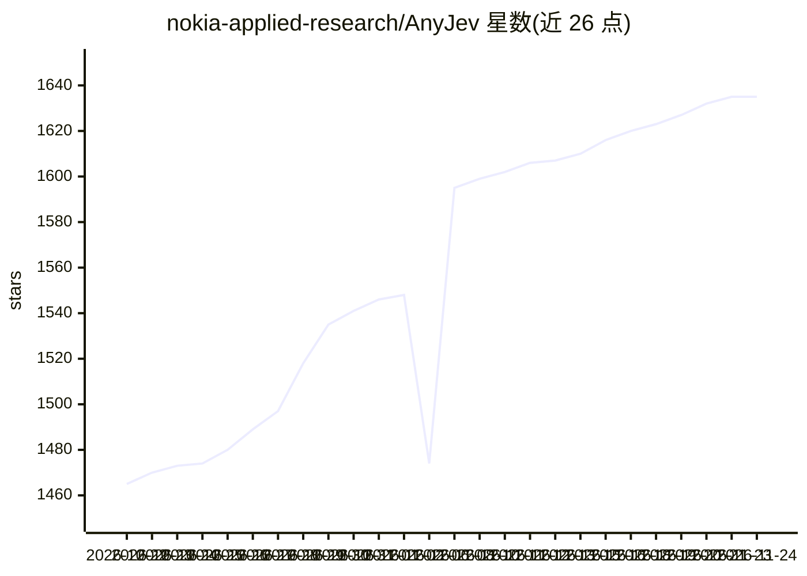

# nokia-applied-research/AnyJev

⭐ 1,635 · Python · Apache-2.0 · 推送 2026-10-21 · [GitHub](https://github.com/nokia-applied-research/AnyJev) · [官网](https://pypi.org/project/anyjev/) · 组织维护 · 中文 README

**把任意 LLM 转成无训练决策模型的 Python 库**

AnyJev 提供 typed decision（choice/yes_no/score）读取层：从 LLM 的 next-token 分布读出带概率的决策。两条路径：训练免费的 Decider（L0 通过 K 次选项轮换平均消除位置偏差与标签先验，无标签无训练）；以及自蒸馏的 Tacit 检查点（1.7B–9B，单次前向出决策，adaptive 模式按上限将低置信决策升级到推理）。支持 transformers/vLLM/SGLang/llama.cpp 后端与 HTTP 网关，附评测脚本与结果 JSON。维护方为 Nokia 研究团队。

## 筛选速览

| 维度 | 判定 | 备注 |
|---|---|---|
| AI 角色 | `ai-native` | 本体是模型或模型工具 |
| 许可风险 | `permissive` | Apache-2.0 |
| 部署形态 | `library` | 以包/库形式分发 |
| 模型依赖 | local-ok | 支持本地模型 |
| 硬件要求 | — | 无带数字的原话,不猜 |
| 安装摩擦 | `low` | 无编译、无系统依赖或容器化 |
| 成熟度 | — | 结构信号不足 |

## 能力要点

- L0 无标签读取：K 次轮换平均去除选项顺序偏差并除以标签先验
- Tacit 自蒸馏检查点 1.7B–9B，单次前向出决策，adaptive 上限升级到推理
- 多后端：transformers、进程内 vLLM、vllm serve、SGLang、llama.cpp(GGUF)
- 旋转预算（rotation budget）在无标签校准下减少读取次数

## 适用场景

- 把客服工单分类为带概率的决策输出并自动化低风险决策
- 让任意开源 LLM 在不训练的情况下输出校准概率
- 通过 HTTP 网关为多客户端提供带升级上限的决策服务

## 场景标签

 · 领域:LLM 基础设施/决策读取

## 证据(README 行号)

> L128: Give the model a state and a **typed question** (a choice, a yes/no or a score). You get back a
> L132: - **AnyJev Training-Free (`Decider`)** works on any open LLM, with no training. Raw label logits
> L221:  Every number in this README is read from committed JSON. Not affiliated with TypeSafe AI or Jev.

## 星数曲线

2026-10-22 1,465 → 2026-11-24 1,635（+170）

---
*卡片 v1 · prompt 1.4 · 生成 2026-11-23 · 置信度 high · 依据 README sha `b77380a781f5` · [字段定义](../../DATASET.md)*
