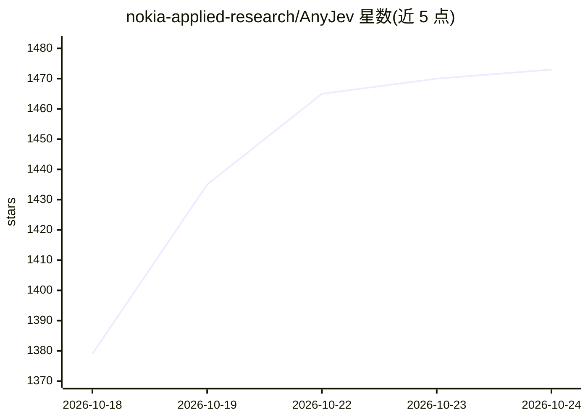

# nokia-applied-research/AnyJev

⭐ 1,473 · Python · Apache-2.0 · 推送 2026-10-21 · [GitHub](https://github.com/nokia-applied-research/AnyJev) · [官网](https://pypi.org/project/anyjev/) · 组织维护 · 中文 README

**把任意 LLM 变成带概率的类型化决策模型（免训练/自蒸馏）**

Python 库，提供两条路径：训练免费的 Decider 从任意开放因果 LM 的 next-token 分布读取类型化决策（choice/yes_no/score），通过选项轮转平均消除位置偏置、无标签去除标签先验，输出带概率与级别标记的决策；自蒸馏的 Tacit 系列检查点（1.7B–9B）单次前向给出决策，可按置信度上限升级到推理。支持 transformers、进程内 vLLM、vllm serve、SGLang、llama.cpp(GGUF) 后端，并提供 HTTP 网关（python -m anyjev.serve，网关自身无鉴权）。面向需要在 LLM 上获得可校准决策输出的开发者。

## 筛选速览

| 维度 | 判定 | 备注 |
|---|---|---|
| AI 角色 | `ai-native` | 本体是模型或模型工具 |
| 许可风险 | `permissive` | Apache-2.0 |
| 部署形态 | `library` | 以包/库形式分发 |
| 模型依赖 | local-ok | 支持本地模型 |
| 硬件要求 | — | 无带数字的原话,不猜 |
| 安装摩擦 | `low` | 无编译、无系统依赖或容器化 |
| 成熟度 | — | 结构信号不足 |

## 能力要点

- L0 免训练免标签消除选项顺序翻转与标签偏置，输出概率决策
- Tacit 自蒸馏检查点（1.7B–9B）单次前向，adaptive 模式按上限升级到推理
- 轮转预算：1% 分歧认证下平均读 7.2/18 次轮转，吞吐提升约 2.2–2.7 倍
- 提供 python -m anyjev.serve HTTP 网关与多后端（vLLM/SGLang/llama.cpp）

## 适用场景

- 客服工单等分类任务上让 LLM 输出带概率、免解析的决策
- 无标注数据场景下做零标签校准的自动化决策（auto-decidable）
- 多客户端共享推理升级配额的决策服务

## 场景标签

 · 领域:LLM 决策/校准

## 证据(README 行号)

> L121: Give the model a state and a **typed question** (a choice, a yes/no or a score). You get back a
> L125: - **AnyJev Training-Free (`Decider`)** works on any open LLM, with no training. Raw label logits
> L128: - **AnyJev Self-Distilled (`Tacit`)** uses the Tacit checkpoints. They are trained by

## 星数曲线

2026-10-18 1,379 → 2026-10-24 1,473（+94）

---
*卡片 v1 · prompt 1.4 · 生成 2026-10-21 · 置信度 high · 依据 README sha `9371bdc26609` · [字段定义](../../DATASET.md)*
