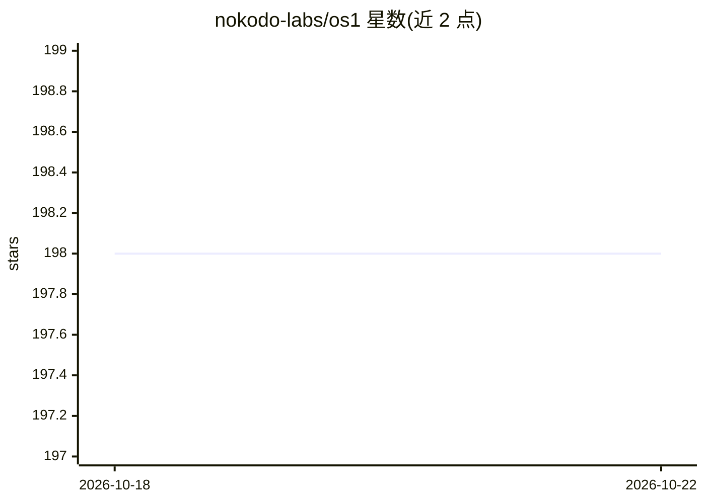

# nokodo-labs/os1

⭐ 198 · Python · NOASSERTION · 推送 2026-10-20 · [GitHub](https://github.com/nokodo-labs/os1) · [官网](https://nokodo.dev) · 组织维护

**可自托管的自主 agent 与协作 AI 平台（alpha 阶段）**

nokodo/OS1 是开源的可自托管 AI 工作区：自主多轮 agent（可派生子 agent、调用工具）、基于 E2B 沙箱的编码 agent（读写代码、跑测试、自动开 PR）、多轮深度研究与报告合成、人类与 AI 共线程的实时协作聊天、跨会话持久记忆、Jinja2 提示词引擎，以及 OIDC/SSO、配额、审计等企业功能。采用 OS1 License（基于 AGPL-3.0 改编、要求署名、保留 AI 训练权）。项目声明处于 alpha 阶段，仓库已迁移至 GitLab，本仓库仅为指针。通过 Docker Compose 部署。

## 筛选速览

| 维度 | 判定 | 备注 |
|---|---|---|
| AI 角色 | `ai-native` | 本体是模型或模型工具 |
| 许可风险 | `none` | NOASSERTION |
| 部署形态 | `self-host` | docker 或自建部署 |
| 模型依赖 | — | README 未给出锁定关系 |
| 硬件要求 | — | 无带数字的原话,不猜 |
| 安装摩擦 | `low` | 无编译、无系统依赖或容器化 |
| 成熟度 | `idea` | |

## 能力要点

- 自主 agent 会话与子 agent 委派，intelligence router 自动选模型
- E2B 沙箱编码 agent：改代码、跑测试、自动开 PR
- 多用户与 AI 混合参与的实时协作线程与消息分支
- OIDC/SSO、角色权限、配额与审计日志等企业功能

## 适用场景

- 团队自托管一个带自主 agent 和深度研究的 AI 协作工作区
- 让编码 agent 在沙箱里改代码、跑测试并自动提 PR
- 在自有基础设施上运行带 SSO 和用量管理的 AI 平台

## 场景标签

`编码 Agent` `AI 助手` `多智能体` · 领域:Agent 开发

## 证据(README 行号)

> L47: nokodo is an intuitive, accessible and powerful open-source AI platform.
> L62: - **multi-turn agent sessions** - agents that plan, act, and iterate until the job is done

## 星数曲线

2026-10-18 198 → 2026-10-22 198（+0）

---
*卡片 v1 · prompt 1.4 · 生成 2026-10-22 · 置信度 high · 依据 README sha `bbc9cc69ba42` · [字段定义](../../DATASET.md)*
