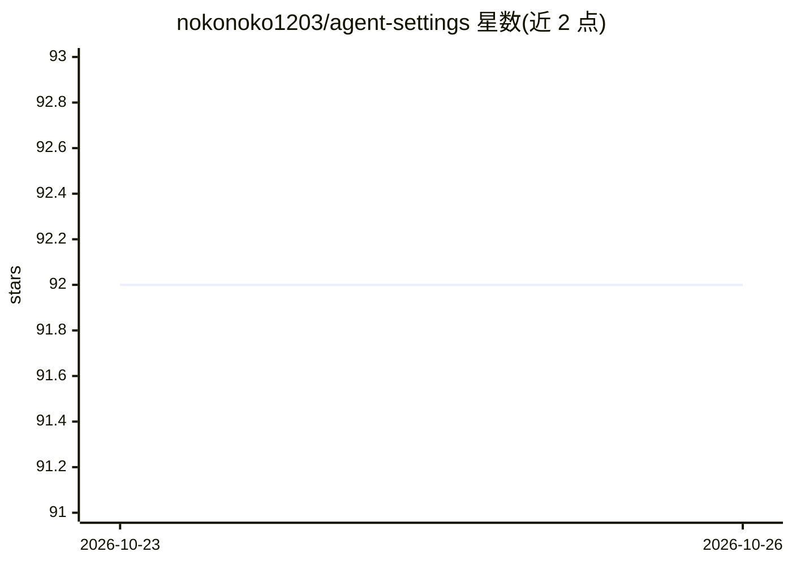

# nokonoko1203/agent-settings

⭐ 92 · Python · MIT · 推送 2026-10-21 · [GitHub](https://github.com/nokonoko1203/agent-settings) · 个人维护

**Claude Code 与 Codex 的个人配置、规则、hook 与技能合集**

个人维护的 AI 编程助手配置集：为 Claude Code 与 Codex 提供统一开发流程与技能集，包括按作业重量（E/0/1/2/R）分级的 triage 记录、调查/设计/实现/评审各阶段技能，以及十余个安全 hook（阻止危险命令、main 直接提交、.env 编辑等）。机制上依赖 uv、python3、jq、make、git、gh、codex 等工具，通过 rsync 复制到 ~/.claude/ 与 ~/.codex/ 使用；旧版轻量配置保留在 v1 标签。日文与英文回复检查等部分内容针对日语使用者定制。

## 筛选速览

| 维度 | 判定 | 备注 |
|---|---|---|
| AI 角色 | `ai-ecosystem` | LLM/agent 周边工具 |
| 许可风险 | `permissive` | MIT |
| 部署形态 | `None` |  |
| 模型依赖 | — | README 未给出锁定关系 |
| 硬件要求 | — | 无带数字的原话,不猜 |
| 安装摩擦 | `low` | 无编译、无系统依赖或容器化 |
| 成熟度 | — | 结构信号不足 |

## 能力要点

- 按重量分级（E/0/1/2/R）的工作流与 harness-log 记录机制
- 十余个 PreToolUse/Stop hook：阻止危险命令、main 提交、.env 编辑、验证证据文件
- Claude Code 与 Codex 共用同一套技能集（调查/设计/实现/评审/运维共 15 个技能）
- Claude Code 可通过 codex 技能把实现任务委托给 Codex CLI

## 适用场景

- 为 Claude Code / Codex 配置统一的安全 hook 与开发流程
- 让 AI 编程助手遵循带证据与评审约束的作业流程
- 参考他人 AI 编程助手的技能与规则组织方式

## 场景标签

 · 领域:开发者工具/AI 编程助手配置

## 证据(README 行号)

> L5: Claude CodeとCodexで使う設定、ルール、hook、スキルをまとめています。`claude/`と`codex/`は同じ開発フローとスキルセットで揃えており、`codex/AGENTS.md`は`claude/CLAUDE
> L73: |イベント|hook|内容|
> L90: `claude/skills/`と`codex/skills/`には同じスキルセットを入れています。

## 星数曲线

2026-10-23 92 → 2026-10-26 92（+0）

---
*卡片 v1 · prompt 1.4 · 生成 2026-10-23 · 置信度 high · 依据 README sha `284c916931aa` · [字段定义](../../DATASET.md)*
