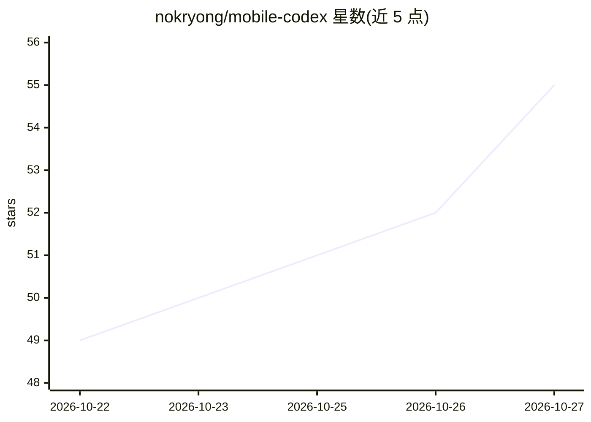

# nokryong/mobile-codex

⭐ 55 · Java · GPL-3.0 · 推送 2026-10-26 · [GitHub](https://github.com/nokryong/mobile-codex) · 个人维护

**Android 上的 Codex 独立客户端，可语音对话并邀请 Claude/Gemini 协作**

围绕 Codex app-server 构建的独立 Android 应用，内置 Codex 的 Android 移植版及 Python、Node.js、Git，无需 Termux 或独立 PC 服务器。功能包括按项目的聊天、语音对话（Codex Live）、文件管理、Git 变更审查、插件/技能/MCP 配置，以及在同一会话中邀请 Claude 与 Gemini（Antigravity）多智能体协作（@提及、并发回复、各自模型与权限设置）。模型推理需联网并持有 Codex 账户，Codex 进程与文件/命令工具在本机运行；仅支持 ARM64/Android 10+，通过 GitHub Release 的 APK 安装。

## 筛选速览

| 维度 | 判定 | 备注 |
|---|---|---|
| AI 角色 | `ai-ecosystem` | LLM/agent 周边工具 |
| 许可风险 | `viral` | GPL-3.0 |
| 部署形态 | `library` | 以包/库形式分发 |
| 模型依赖 | locked-api |  |
| 硬件要求 | — | 无带数字的原话,不猜 |
| 安装摩擦 | `medium` | 含编译或系统依赖之一 |
| 成熟度 | — | 结构信号不足 |

## 能力要点

- 内置 Codex Android 移植版与 Python/Node.js/Git，无需 Termux 或 PC 服务器
- 同一聊天中邀请 Claude 与 Gemini，@提及指定回复者，支持并发回复
- Codex Live 语音对话，可后台/锁屏持续，结束通话不中断任务
- 多 ChatGPT 账户本地保存与切换，凭据存于应用私有存储

## 适用场景

- 在手机上直接使用 Codex 完成项目编码任务
- 通过语音向 Codex 下达项目工作指令并听取结果
- 在同一会话中让 Claude 与 Gemini 参与多智能体协作讨论

## 场景标签

`编码 Agent` `语音 Agent` `多智能体` · 领域:Agent 开发

## 证据(README 行号)

> L25: Mobile Codex is an independent Android client built around the Codex app-server. It bundles an Android port of Code
> L60: - **Invite agents:** Add Claude and Gemini (Antigravity) from the composer. Participants read the shared conversati

## 星数曲线

2026-10-22 49 → 2026-10-27 55（+6）

---
*卡片 v1 · prompt 1.4 · 生成 2026-10-24 · 置信度 mid · 依据 README sha `7406ba97c0b1` · [字段定义](../../DATASET.md)*
