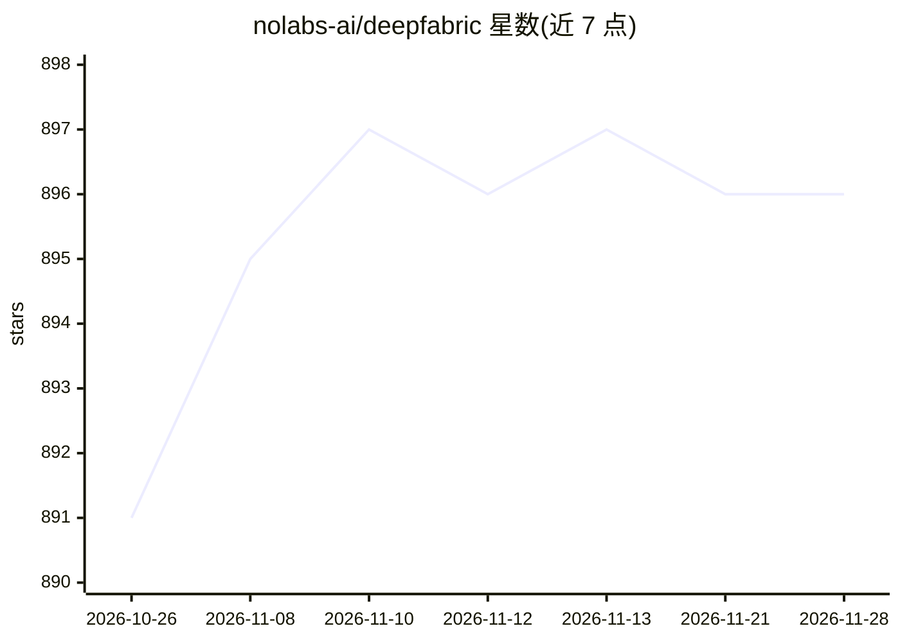

# nolabs-ai/deepfabric

⭐ 896 · Python · Apache-2.0 · 推送 2026-11-26 · [GitHub](https://github.com/nolabs-ai/deepfabric) · [官网](http://docs.deepfabric.dev) · 组织维护

**面向模型微调的合成训练数据生成与评测管线**

以库、CLI 和 YAML 配置三种方式使用的合成数据工具链：通过主题图算法生成覆盖各子主题的训练样本，结合推理链与工具调用模式，工具可在 WebAssembly 沙箱（Spin 框架）中真实执行，输出带模式校验的 HuggingFace 数据集，可直接导入 TRL、Unsloth 等训练框架；训练后提供内置评测引擎，计算工具选择准确率、参数准确率、执行成功率等指标，支持 LoRA 适配器与 Ollama 后端评测。

## 筛选速览

| 维度 | 判定 | 备注 |
|---|---|---|
| AI 角色 | `ai-ecosystem` | LLM/agent 周边工具 |
| 许可风险 | `permissive` | Apache-2.0 |
| 部署形态 | `self-host` | docker 或自建部署 |
| 模型依赖 | local-ok | 支持本地模型 |
| 硬件要求 | — | 无带数字的原话,不猜 |
| 安装摩擦 | `low` | 无编译、无系统依赖或容器化 |
| 成熟度 | — | 结构信号不足 |

## 能力要点

- 主题图生成算法引导样本覆盖子主题并避免冗余
- 约束解码与响应校验，工具在隔离 WebAssembly 环境真实执行
- 工具定义可从 MCP 服务器 schema 导入并自动 mock
- 内置评测引擎输出 tool_selection_accuracy 等多项指标

## 适用场景

- 为智能体微调生成带工具调用轨迹的训练数据
- 微调后在保留集上评测模型的工具调用能力
- 将生成数据集上传 HuggingFace 并接入 TRL/Unsloth 训练流程
- 本地 Ollama 后端下生成或评测以保护隐私

## 场景标签

`模型评测` `微调` · 领域:评测与运维

## 证据(README 行号)

> L32: **DeepFabric** generates synthetic training data for language models and agent evaluations. By combining reasoning 
> L40: Post-training, DeepFabric's built-in evaluation engine assesses model performance, whereby models prove their capab

## 星数曲线

2026-10-26 891 → 2026-11-28 896（+5）

---
*卡片 v1 · prompt 1.4 · 生成 2026-11-24 · 置信度 high · 依据 README sha `158be6f43f4b` · [字段定义](../../DATASET.md)*
