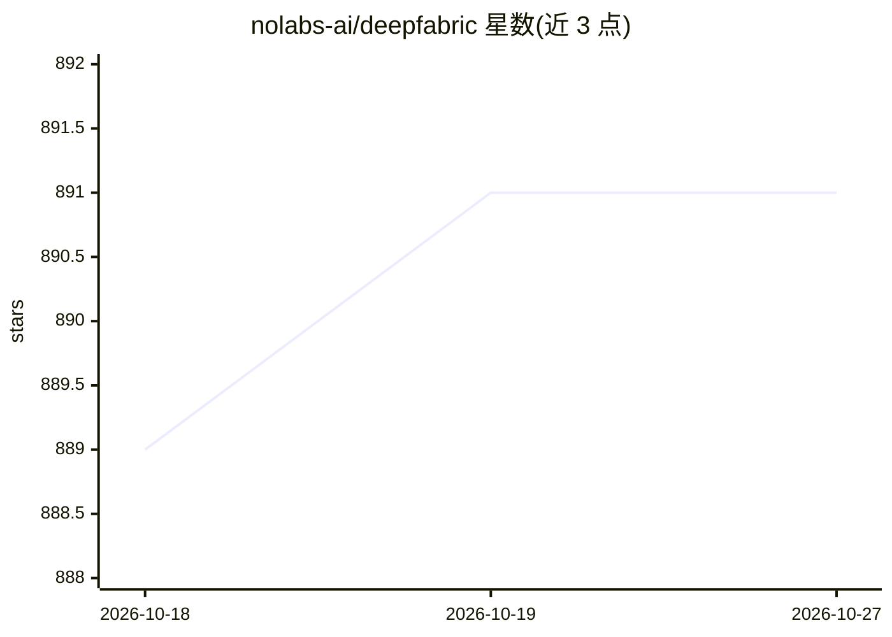

# nolabs-ai/deepfabric

⭐ 891 · Python · Apache-2.0 · 推送 2026-10-22 · [GitHub](https://github.com/nolabs-ai/deepfabric) · [官网](http://docs.deepfabric.dev) · 组织维护

**为 LLM 与 agent 训练生成合成数据集并评测的流水线库**

DeepFabric 为语言模型和 agent 评测生成合成训练数据：通过主题图算法引导样本生成以保证多样性与领域覆盖，结合约束解码、响应校验与在隔离 WebAssembly（Spin）环境中的真实工具执行（ReAct 循环），生成符合结构化 schema 的数据集。工具定义可从 MCP server schema 导入。生成的数据集可上传 Hugging Face 并导入 TRL、Unsloth、Axolotl 训练，训练后内置评测引擎在未见任务上计算工具选择准确率等指标。以 pip 库、CLI 与 YAML 配置三种方式使用，支持 OpenAI/Anthropic/Gemini/Ollama/OpenRouter 等提供商。

## 筛选速览

| 维度 | 判定 | 备注 |
|---|---|---|
| AI 角色 | `ai-ecosystem` | LLM/agent 周边工具 |
| 许可风险 | `permissive` | Apache-2.0 |
| 部署形态 | `self-host` | docker 或自建部署 |
| 模型依赖 | local-ok | 支持本地模型 |
| 硬件要求 | — | 无带数字的原话,不猜 |
| 安装摩擦 | `low` | 无编译、无系统依赖或容器化 |
| 成熟度 | — | 结构信号不足 |

## 能力要点

- 主题图算法引导生成，保证子题覆盖与多样性
- Spin/WebAssembly 沙箱中真实执行工具（ReAct 循环），非模拟输出
- 数据集可直接上传 Hugging Face 并导入 TRL/Unsloth/Axolotl
- 内置评测引擎：tool_selection_accuracy、execution_success_rate 等指标

## 适用场景

- 为微调生成含工具调用轨迹的领域数据集
- 训练后在未见任务上评测模型工具调用能力
- 配合本地 Ollama 做私有数据生成与评测

## 场景标签

`模型评测` · 领域:评测与运维

## 证据(README 行号)

> L32: **DeepFabric** generates synthetic training data for language models and agent evaluations. By combining reasoning 
> L137: DeepFabric provides a comprehensive evaluation system to measure how well your fine-tuned models perform on tool-c

## 星数曲线

2026-10-18 889 → 2026-10-27 891（+2）

---
*卡片 v1 · prompt 1.4 · 生成 2026-10-21 · 置信度 high · 依据 README sha `40a311d51984` · [字段定义](../../DATASET.md)*
