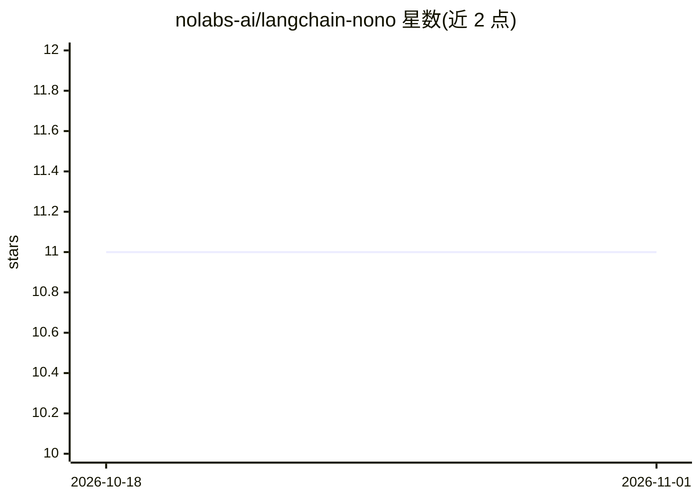

# nolabs-ai/langchain-nono

⭐ 11 · Python · Apache-2.0 · 推送 2026-09-15 · [GitHub](https://github.com/nolabs-ai/langchain-nono) · [官网](https://nono.sh) · 组织维护

**给 LangChain Deep Agents 的内核级沙箱后端（Landlock/Seatbelt）**

以 Python 库形式提供的沙箱执行后端：每次 execute() 时 fork 进程并在子进程中应用操作系统级限制（Linux 用 Landlock LSM、macOS 用 Seatbelt），由内核强制执行，无需容器。功能包括策略化文件系统访问控制、虚拟工作区路径映射、经本地代理的网络过滤与出站凭据注入（沙箱代码只见幻影 token）、内容寻址的工作区快照与回滚、含 Merkle 根与会话元数据的审计记录。面向在 Linux/macOS 上运行 Deep Agents 的开发者，通过 pip 安装。

## 筛选速览

| 维度 | 判定 | 备注 |
|---|---|---|
| AI 角色 | `ai-ecosystem` | LLM/agent 周边工具 |
| 许可风险 | `permissive` | Apache-2.0 |
| 部署形态 | `library` | 以包/库形式分发 |
| 模型依赖 | — | README 未给出锁定关系 |
| 硬件要求 | — | 无带数字的原话,不猜 |
| 安装摩擦 | `low` | 无编译、无系统依赖或容器化 |
| 成熟度 | — | 结构信号不足 |

## 能力要点

- OS 级沙箱：Linux Landlock（内核 5.13+）/ macOS Seatbelt（10.15+），内核强制、无需容器
- 代理凭据注入：沙箱代码持有幻影 token，真实密钥留在宿主侧
- 内容寻址快照与工作区回滚
- 策略化访问控制与会话元数据审计（Merkle 根、网络事件）

## 适用场景

- 让 agent 生成的代码在受限沙箱中执行，防止越权访问文件与网络
- 在沙箱内安全调用外部 API 而不暴露真实密钥
- 对 agent 会话工作区做快照、diff 与回滚

## 场景标签

`网络安全` · 领域:学习与行业

## 证据(README 行号)

> L3: OS-enforced sandbox backend for LangChain Deep Agents using nono.
> L5: Kernel-level sandboxing, network filtering, policy-based access control, credential injection, and filesystem snapsh
> L166: 2. Applies OS-level sandbox restrictions in the child (Landlock or Seatbelt)

## 星数曲线

2026-10-18 11 → 2026-11-01 11（+0）

---
*卡片 v1 · prompt 1.4 · 生成 2026-11-01 · 置信度 high · 依据 README sha `269cf35e6e7a` · [字段定义](../../DATASET.md)*
