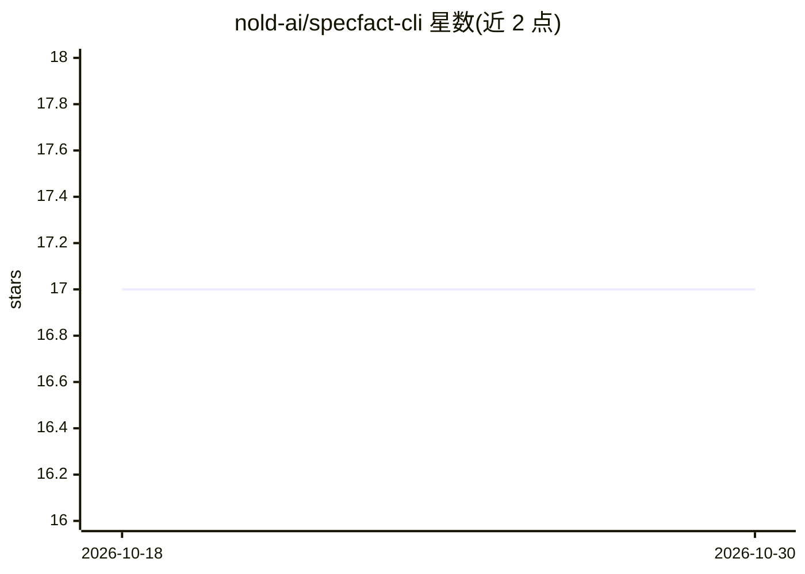

# nold-ai/specfact-cli

⭐ 17 · Python · Apache-2.0 · 推送 2026-10-26 · [GitHub](https://github.com/nold-ai/specfact-cli) · [官网](https://docs.specfact.io/) · 组织维护

**面向 Python 团队的本地确定性代码审查与 AI 膨胀防御 CLI**

本地优先的 Python CLI，围绕 AI 辅助交付提供确定性验证层：代码审查报告 ai_bloat 建议与清理预测（AI-bloat 指数、修复包），可将 JSON 报告交接给 Claude、Codex、Cursor、Copilot 等 AI IDE 执行清理后复检。还支持从存量代码逆向提取结构、消费 Spec Kit/OpenSpec 等上游规划输入做漂移校验，并可在 pre-commit、CI 中复用同一套规则。无需 API key、离线运行、无内置模型依赖，官方工作流以独立模块包形式安装。

## 筛选速览

| 维度 | 判定 | 备注 |
|---|---|---|
| AI 角色 | `ai-ecosystem` | LLM/agent 周边工具 |
| 许可风险 | `permissive` | Apache-2.0 |
| 部署形态 | `library` | 以包/库形式分发 |
| 模型依赖 | — | README 未给出锁定关系 |
| 硬件要求 | — | 无带数字的原话,不猜 |
| 安装摩擦 | `low` | 无编译、无系统依赖或容器化 |
| 成熟度 | — | 结构信号不足 |

## 能力要点

- 确定性检测 AI 膨胀代码形态（冗余包装、透传 lambda 等）并输出清理预测
- JSON 报告作为可移植交接产物供 AI IDE/无头 agent 使用
- 同一套检查可在本地、pre-commit、CI 中复用
- 模块化体系：核心 CLI 加官方 workflow 模块包（project/backlog/code/spec/govern 等）

## 适用场景

- AI IDE 辅助开发后，在 PR 前拦截膨胀代码并生成清理修复包
- 存量仓库逆向提取结构，控制 backlog/spec 与代码漂移
- 团队在本地与 CI 间保持同一套确定性审查门禁

## 场景标签

`代码审查` · 领域:编码与开发

## 证据(README 行号)

> L50: SpecFact is the local AI-bloat defense CLI for Python-first teams using AI IDEs. The Code Review bundle reports `ai
> L68: - **Stays local-first** — no cloud account, no vendor lock-in, no built-in model dependency

## 星数曲线

2026-10-18 17 → 2026-10-30 17（+0）

---
*卡片 v1 · prompt 1.4 · 生成 2026-10-29 · 置信度 high · 依据 README sha `f038540b48dc` · [字段定义](../../DATASET.md)*
