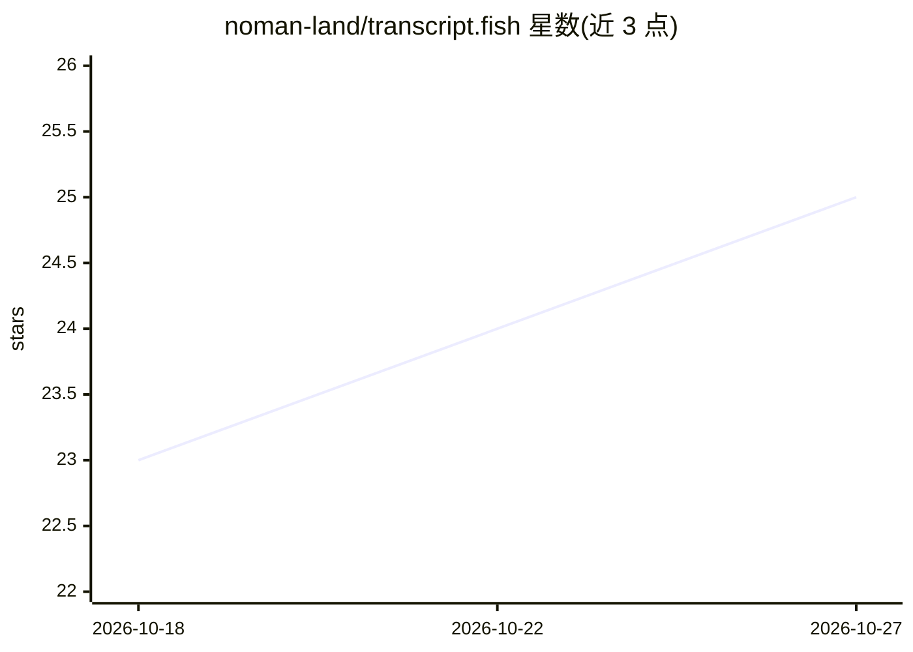

# noman-land/transcript.fish

⭐ 25 · TypeScript · 推送 2025-11-24 · [GitHub](https://github.com/noman-land/transcript.fish) · [官网](https://transcript.fish/) · 个人维护

**非官方 No Such Thing As A Fish 播客节目转录文本网站**

收录 No Such Thing As A Fish 播客的非官方节目转录文本并以网站形式提供。Web 端为 JavaScript 应用（npm 安装依赖并启动开发服务器）；数据管线用 Python 虚拟环境，从 RSS feed 下载节目音频，调用 Whisper 模型（默认 large-v2，可切换更小模型）转录并写入数据库，脚本幂等可断点续跑；数据库切分后经 rclone 同步到 Cloudflare R2。截至 2025-02-08 已覆盖 568 期，音频约 24.2GB。

## 筛选速览

| 维度 | 判定 | 备注 |
|---|---|---|
| AI 角色 | `ai-native` | 本体是模型或模型工具 |
| 许可风险 | `none` | — |
| 部署形态 | `library` | 以包/库形式分发 |
| 模型依赖 | — | README 未给出锁定关系 |
| 硬件要求 | — | 无带数字的原话,不猜 |
| 安装摩擦 | `low` | 无编译、无系统依赖或容器化 |
| 成熟度 | — | 结构信号不足 |

## 能力要点

- Whisper 模型转录播客音频（默认 large-v2，可选 medium.en/small.en/tiny.en）
- 转换脚本幂等，可中断后从上一期继续
- 数据库分块并经 rclone 同步到 Cloudflare R2

## 适用场景

- 查阅 No Such Thing As A Fish 节目的文本转录
- 本地运行网站检索转录内容
- 批量转录未处理的播客节目并更新数据库

## 场景标签

 · 领域:语音转录/知识站点

## 证据(README 行号)

> L3: Unofficial No Such Thing As A Fish episode transcripts.
> L41: Run `npm run convert 146`
> L49: **NOTE** The first time this script is run, it needs to download the Whisper model, which requires `local_files_onl

## 星数曲线

2026-10-18 23 → 2026-10-27 25（+2）

---
*卡片 v1 · prompt 1.4 · 生成 2026-10-27 · 置信度 mid · 依据 README sha `1a25e1961230` · [字段定义](../../DATASET.md)*
