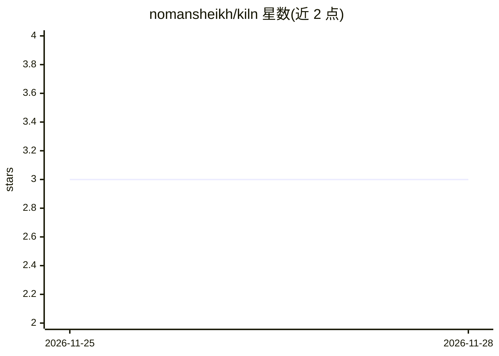

# nomansheikh/kiln

⭐ 3 · Swift · MIT · 推送 2026-11-26 · [GitHub](https://github.com/nomansheikh/kiln) · 个人维护

**本地运行图像/语音/3D 生成模型的 macOS 原生应用**

Kiln 是面向 Apple Silicon Mac 的本地模型应用：从 Hugging Face 下载模型并生成图像（基于 stable-diffusion.cpp）、语音转文字（whisper.cpp）、文字转语音（含多说话人脚本、声音复制与设计）、图片转 3D 对象（trellis.cpp，可导出 GLB/USDZ/OBJ）。模型以 JSON recipe 形式策展，固定 commit 与 SHA-256，下载可断点续传并标注内存适配。全部推理在本地辅助进程中运行并沙箱化，无需 Python 或命令行。为早期版本（0.1.0），仅部分 recipe 经过端到端运行验证，无 Intel 构建。

## 筛选速览

| 维度 | 判定 | 备注 |
|---|---|---|
| AI 角色 | `ai-native` | 本体是模型或模型工具 |
| 许可风险 | `permissive` | MIT |
| 部署形态 | `desktop` | 安装包/桌面程序 |
| 模型依赖 | — | README 未给出锁定关系 |
| 硬件要求 | — | 无带数字的原话,不猜 |
| 安装摩擦 | `medium` | 含编译或系统依赖之一 |
| 成熟度 | `idea` | |

## 能力要点

- 图像生成、语音转写、文字转语音、图片转 3D 四类本地推理
- 33 个策展 recipe，固定 commit 与 SHA-256 校验，断点续传下载
- 内存适配标注（fits/tight/too large）与按需选择量化版本
- 辅助进程沙箱化，无账号、无分析、无崩溃上报

## 适用场景

- 在 Mac 上不装 Python 就能本地生成图像
- 把录音或音频文件转成文字稿
- 从照片生成可导出的 3D 模型
- 用自定义声音朗读多说话人脚本

## 场景标签

`图像生成` `语音识别` `语音合成` · 领域:内容生成

## 证据(README 行号)

> L3: Kiln is a native macOS app that downloads models from Hugging Face and runs them on your own Mac. It makes images wi
> L5: It is for people with an Apple Silicon Mac who want to try image, speech and 3D models locally without setting up Py

## 星数曲线

2026-11-25 3 → 2026-11-28 3（+0）

---
*卡片 v1 · prompt 1.4 · 生成 2026-11-24 · 置信度 high · 依据 README sha `ebcad0023dc0` · [字段定义](../../DATASET.md)*
