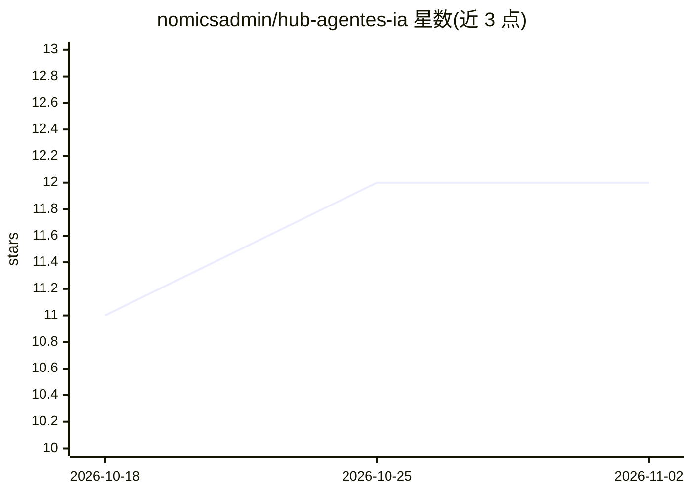

# nomicsadmin/hub-agentes-ia

⭐ 12 · TypeScript · MIT · 推送 2026-09-25 · [GitHub](https://github.com/nomicsadmin/hub-agentes-ia) · [官网](https://tech.gruponomics.com.br) · 组织维护

**非程序员自建 AI agent 付费知识库模板**

基于 Next.js + Supabase + OpenAI 的开源 AI agent hub 模板：上传自有 PDF/转录材料，创建仅依据该材料回答的 RAG agent，内置登录认证、自动销售（购买后发邀请、退款收回访问）、engagement 管理面板、AI 生成 PDF、音频与附件理解、无代码 prompt 编辑。支持 PWA 安装与明暗主题，部署到 Vercel。提供两条路径：用 Claude Code 等 AI 工具自动搭建，或按 8 步手动流程（git clone、npm install、Supabase 初始化、OpenAI key、Vercel 发布）。需 Node 22.18+。

## 筛选速览

| 维度 | 判定 | 备注 |
|---|---|---|
| AI 角色 | `ai-native` | 本体是模型或模型工具 |
| 许可风险 | `permissive` | MIT |
| 部署形态 | `library` | 以包/库形式分发 |
| 模型依赖 | — | README 未给出锁定关系 |
| 硬件要求 | — | 无带数字的原话,不猜 |
| 安装摩擦 | `low` | 无编译、无系统依赖或容器化 |
| 成熟度 | — | 结构信号不足 |

## 能力要点

- RAG agent 仅基于用户上传材料回答，附引用来源
- 购买自动开通访问、退款自动收回的付费墙
- engagement 面板显示 7/15/30 天活跃情况
- 不写代码即可通过 Claude Code 等 AI 工具完成搭建与发布

## 适用场景

- 课程创作者把资料变成付费问答 agent
- 咨询师/教练搭建按客户收费的 AI 知识服务
- 非程序员用 AI 工具指导在一下午内部署上线

## 场景标签

`RAG` `文档问答` · 领域:知识与检索

## 证据(README 行号)

> L15:  Open-source AI agent hub template · Next.js + Supabase + OpenAI · RAG chatbot with auth, payments and admin dashbo
> L23: |💬 **Chat com resposta ao vivo** O texto aparece enquanto o agente escreve.|📚 **Agentes treinados nos seus PDFs** R
> L49: Pronto. A IA vai te entrevistar, criar os agentes, aplicar o seu visual, te guiar clique a clique no Supabase, na O

## 星数曲线

2026-10-18 11 → 2026-11-02 12（+1）

---
*卡片 v1 · prompt 1.4 · 生成 2026-11-01 · 置信度 high · 依据 README sha `4395d466651d` · [字段定义](../../DATASET.md)*
