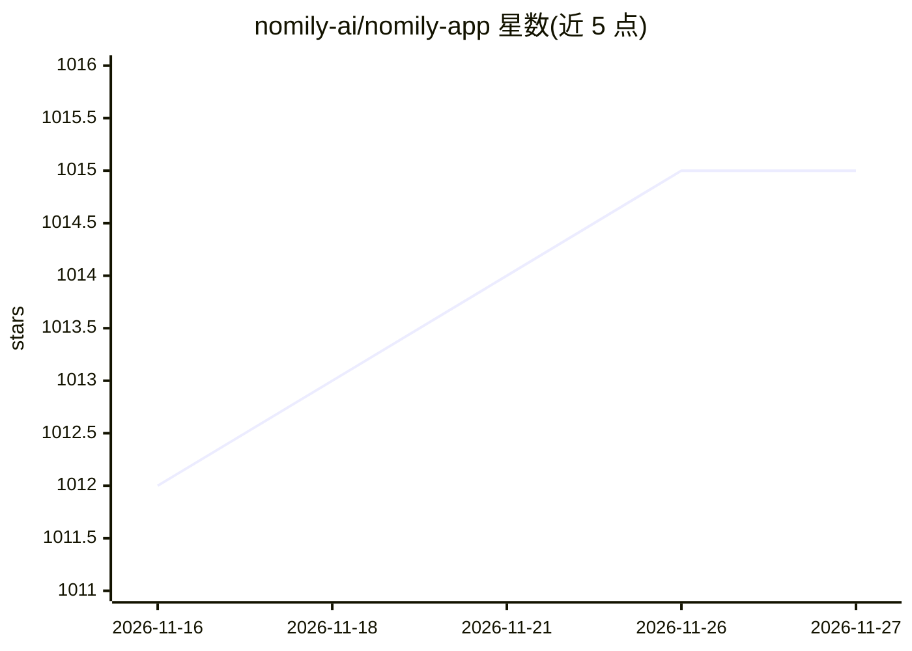

# nomily-ai/nomily-app

⭐ 1,015 · NOASSERTION · 推送 2026-11-19 · [GitHub](https://github.com/nomily-ai/nomily-app) · [官网](https://geekis.com) · 组织维护

**BYOK 录音伴侣应用：转录、说话人分离、AI 摘要**

面向 Vobot V05E 录音器、Apple Watch 与 iPhone 导入音频的 BYOK 原生客户端工作流。用户自行配置 ASR 与 LLM 提供商：Azure Speech 或本地 faster-whisper 兼容端点做转录与最多 10 说话人分离；OpenAI、Anthropic、Gemini、OpenRouter、Ollama 或自定义 OpenAI 兼容端点生成摘要、标题与翻译。本仓库为项目入口，可运行客户端分布在 nomily-ios 与 nomily-android 两个原生仓库，无安装包与 Docker 部署。无订阅费，第三方服务费用由用户承担。

## 筛选速览

| 维度 | 判定 | 备注 |
|---|---|---|
| AI 角色 | `ai-native` | 本体是模型或模型工具 |
| 许可风险 | `none` | NOASSERTION |
| 部署形态 | `library` | 以包/库形式分发 |
| 模型依赖 | local-ok | 支持本地模型 |
| 硬件要求 | — | 无带数字的原话,不猜 |
| 安装摩擦 | `medium` | 含编译或系统依赖之一 |
| 成熟度 | — | 结构信号不足 |

## 能力要点

- 支持本地 faster-whisper 兼容 ASR 端点（WebSocket 12300 / HTTP 12301）与 Azure Speech 转录
- LLM 提供商可配置：OpenAI、Anthropic、Gemini、OpenRouter、Ollama 或自定义 OpenAI 兼容端点
- 原生 iOS / Apple Watch 与 Android 实现，非跨平台封装
- 可选 iCloud Drive / NAS / Nextcloud 自有存储保存与同步

## 适用场景

- 录完会议后用自己配置的 ASR 与 LLM 生成转录与摘要
- 在局域网内用本地 Whisper 和 Ollama 处理录音，不经第三方云
- 用 Apple Watch 录音并同步到 iPhone 做整理与总结

## 场景标签

`语音识别` · 领域:感知与多模态

## 证据(README 行号)

> L22: ASR transcription, speaker diarization, AI summaries, and local ASR endpoint
> L80: - Transcribes live or recorded audio through Azure Speech or a user-operated
> L83: - Generates summaries, titles, and translations with a configured LLM provider:

## 星数曲线

2026-11-16 1,012 → 2026-11-27 1,015（+3）

---
*卡片 v1 · prompt 1.4 · 生成 2026-11-20 · 置信度 high · 依据 README sha `3d7a7c02b2f4` · [字段定义](../../DATASET.md)*
