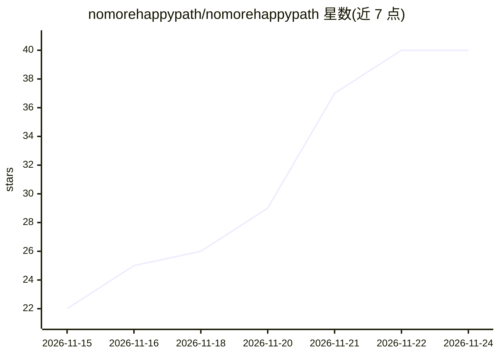

# nomorehappypath/nomorehappypath

⭐ 40 · Python · Apache-2.0 · 推送 2026-11-22 · [GitHub](https://github.com/nomorehappypath/nomorehappypath) · [官网](https://nomorehappypath.com) · 个人维护

**用你已有的 AI 订阅运行多 agent 软件交付流水线**

开源的 AI 软件交付系统：模拟软件公司的部门分工，用真实编码 agent（Codex CLI、Claude Code CLI，可选 Gemini 的 Antigravity CLI）扮演 builder、独立评审与 CTO 三种角色，评审者必须来自与构建者不同的厂商。流程含 26 步六阶段：先写测试并证明可失败后锁定，构建者按测试实现且不可改测试，安全与代码审计检查，用户以 CEO 身份最终验收。提供本地 Mission Control 网页端监控每步与成本；运行在用户自己的账号订阅上。需 macOS 13+ 或 Linux、Python 3.9+，并安装至少两种 CLI。

## 筛选速览

| 维度 | 判定 | 备注 |
|---|---|---|
| AI 角色 | `ai-ecosystem` | LLM/agent 周边工具 |
| 许可风险 | `permissive` | Apache-2.0 |
| 部署形态 | `desktop` | 安装包/桌面程序 |
| 模型依赖 | locked-api |  |
| 硬件要求 | — | 无带数字的原话,不猜 |
| 安装摩擦 | `low` | 无编译、无系统依赖或容器化 |
| 成熟度 | — | 结构信号不足 |

## 能力要点

- 26 步六阶段流水线：测试先行、锁定测试、独立跨厂商评审、用户验收
- 三角色（builder/评审/CTO）可分别指定 Codex、Claude 或 Gemini
- 平台软件独占项目看板写入权，agent 仅能经受控命令修改
- 操作系统级写沙箱限制 agent 只能写项目目录
- Finance 按公开 API 价格估算每任务的 Claude/Codex 成本

## 适用场景

- 让多个 AI agent 按规范流程完成从需求到验收的软件开发
- 用自己已有的 AI 订阅运行并监控 agent 团队的任务与成本
- 要求跨厂商独立评审与锁定测试来约束 AI 生成代码质量

## 场景标签

`多智能体` `编码 Agent` `代码审查` · 领域:Agent 开发

## 证据(README 行号)

> L5: NoMoreHappyPath (nomorehappypath.com) is an open-source delivery system for building commercial software with AI age
> L57: 4. **In Settings:** choose a provider for each of the three roles (Delivery, Reviewer, CTO) from the CLIs you insta
> L78: - **A team of agents.** A builder, an independent reviewer from a different AI company, and a CTO that watches the 

## 星数曲线

2026-11-15 22 → 2026-11-24 40（+18）

---
*卡片 v1 · prompt 1.4 · 生成 2026-11-18 · 置信度 mid · 依据 README sha `f75e00788d85` · [字段定义](../../DATASET.md)*
