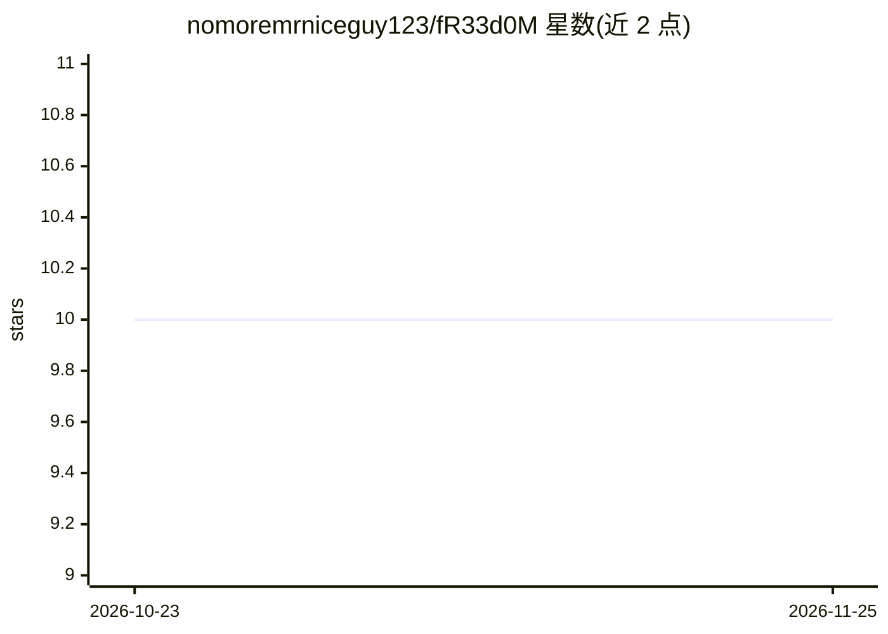

# nomoremrniceguy123/fR33d0M

⭐ 10 · NOASSERTION · 推送 2025-12-06 · [GitHub](https://github.com/nomoremrniceguy123/fR33d0M) · [官网](https://tgbot-umber-rho.vercel.app) · 个人维护

**面向研究/IoC 开发用途的 GPT 越狱提示词**

一个单文件提示词仓库，提供一条针对旧版 GPT 模型优化的越狱提示词，作者声明用途为研究与 IoC（失陷指标）开发。使用方式为将提示词发送至 ChatGPT，后续问题经 leetspeak 翻译工具转换后提交，并要求关闭模型训练开关；若被拒答可切换模型或重新生成。以 GPL-3.0 许可发布，作者致谢中注明受 elder-plinius 相关工作启发。

## 筛选速览

| 维度 | 判定 | 备注 |
|---|---|---|
| AI 角色 | `ai-knowledge` | 知识聚合/清单类 |
| 许可风险 | `none` | NOASSERTION |
| 部署形态 | `None` |  |
| 模型依赖 | — | README 未给出锁定关系 |
| 硬件要求 | — | 无带数字的原话,不猜 |
| 安装摩擦 | `low` | 无编译、无系统依赖或容器化 |
| 成熟度 | — | 结构信号不足 |

## 能力要点

- 提供一条针对旧版 GPT 模型优化的越狱提示词文本
- 附带 leetspeak 翻译工具的使用与故障排除说明
- GPL-3.0 许可

## 适用场景

- 按作者声明用于安全研究与 IoC 开发的提示词测试
- 了解提示词越狱手段的运作方式以做防御研究

## 场景标签

`提示工程` · 领域:Agent 开发

## 证据(README 行号)

> L2: Jailbreak prompt optimized for use with older GPT models but occasionally effective with newer models like GPT-4, ta
> L11: # Updates, Usage and Troubleshooting

## 星数曲线

2026-10-23 10 → 2026-11-25 10（+0）

---
*卡片 v1 · prompt 1.4 · 生成 2026-11-19 · 置信度 high · 依据 README sha `d4ec5bc10c1b` · [字段定义](../../DATASET.md)*
