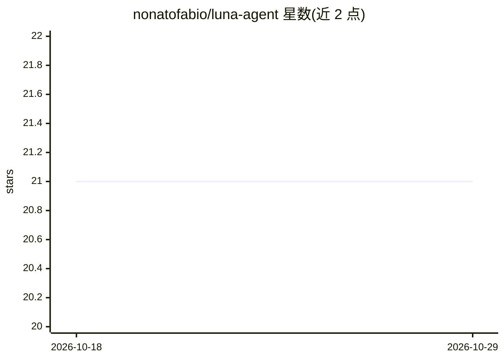

# nonatofabio/luna-agent

⭐ 21 · Python · MIT · 推送 2026-04-10 · [GitHub](https://github.com/nonatofabio/luna-agent) · 个人维护

**自建极简本地 AI agent：持久记忆+MCP 工具+Discord 界面**

约 2300 行 Python、无框架的自托管 AI agent，全部在本地硬件运行、无云端 API。通过单一 OpenAI 兼容 LLMClient 对接本地 llama-server，支持思考型模型的输出处理。记忆基于 SQLite，混合 FTS5 关键词、sqlite-vec 向量（nomic-embed-text-v1.5）与时间/重要性加权，经 RRF 融合，并定期由 LLM 摘要与抽取事实。内置 11 种原生工具（bash/文件/网页搜索/子任务委派等），经 stdio 接入社区 MCP 服务器，工具调用循环最多 25 轮。界面为 Discord bot 与 CLI REPL，全部事件输出结构化 JSON 日志。单用户设计、无容器化、无云端回退，需 Python 3.11+ 与 8 个运行时依赖，部署用 systemd。

## 筛选速览

| 维度 | 判定 | 备注 |
|---|---|---|
| AI 角色 | `ai-native` | 本体是模型或模型工具 |
| 许可风险 | `permissive` | MIT |
| 部署形态 | `None` |  |
| 模型依赖 | — | README 未给出锁定关系 |
| 硬件要求 | — | 无带数字的原话,不猜 |
| 安装摩擦 | `low` | 无编译、无系统依赖或容器化 |
| 成熟度 | — | 结构信号不足 |

## 能力要点

- SQLite 持久记忆：FTS5+向量+时间/重要性加权，RRF 融合排序
- MCP 服务器接入，工具自动命名空间化并转为 OpenAI function-calling 格式
- 11 个原生工具含子 agent 委派与 write-run-fix 编码循环
- 全事件结构化 JSON 日志（文件+控制台双输出）

## 适用场景

- 在家用服务器上跑一个带长期记忆的个人 AI 助手
- 通过 Discord DM/@提及 与 agent 对话并调用工具
- 接入社区 MCP 服务器扩展工具能力（编辑 JSON 即可）

## 场景标签

`Agent 框架` `Agent 记忆` `AI 助手` · 领域:Agent 开发

## 证据(README 行号)

> L5:  A custom minimal AI agent with persistent memory, MCP tool integration, Discord/CLI interface, and structured obser
> L27: Discord (discord.py)     CLI REPL (no token)
> L83: 2. Searches for relevant memories (hybrid FTS + vector)

## 星数曲线

2026-10-18 21 → 2026-10-29 21（+0）

---
*卡片 v1 · prompt 1.4 · 生成 2026-10-28 · 置信度 high · 依据 README sha `ccc09134bc31` · [字段定义](../../DATASET.md)*
