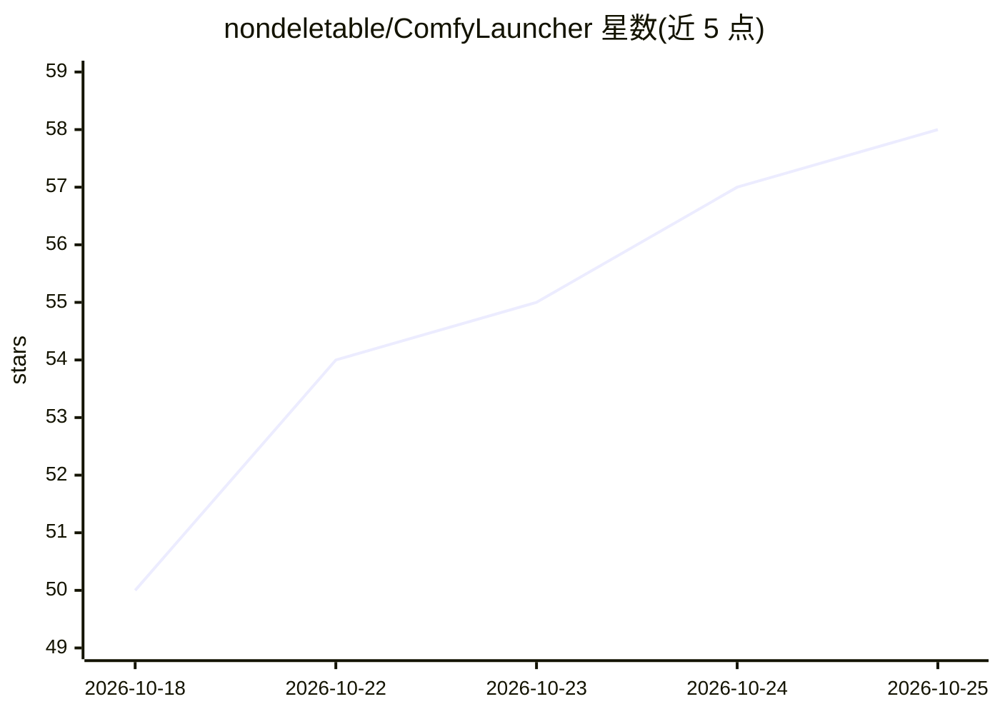

# nondeletable/ComfyLauncher

⭐ 58 · Python · MIT · 推送 2026-10-15 · [GitHub](https://github.com/nondeletable/ComfyLauncher) · 个人维护 · 中文 README

**便携版 ComfyUI 的桌面启动器与轻量浏览器**

面向使用便携版（portable）ComfyUI 用户的桌面工具：支持添加并管理多个 ComfyUI 构建实例，一键启动并按实例自定义启动参数、名称与图标；内置低内存占用的专用浏览器替代默认浏览器打开界面（README 称闲置内存比 Chrome 低 30%），并可隐藏 CMD 窗口、将输出流转入内置控制台；提供打开输出目录、刷新/重启/停止服务器等快捷操作。以 Releases 安装包分发，Windows 需 WebView2 Runtime，Linux 已支持，macOS 在路线图中。

## 筛选速览

| 维度 | 判定 | 备注 |
|---|---|---|
| AI 角色 | `ai-ecosystem` | LLM/agent 周边工具 |
| 许可风险 | `permissive` | MIT |
| 部署形态 | `desktop` | 安装包/桌面程序 |
| 模型依赖 | — | README 未给出锁定关系 |
| 硬件要求 | — | 无带数字的原话,不猜 |
| 安装摩擦 | `low` | 无编译、无系统依赖或容器化 |
| 成熟度 | — | 结构信号不足 |

## 能力要点

- 多实例启动管理，按实例自定义启动参数/名称/图标
- 轻量专用浏览器替代默认浏览器（闲置 RAM 比 Chrome 低 30%，实测于 Win10/11）
- 可隐藏 CMD 窗口并将输出流转入内置控制台
- 服务器状态指示与刷新/重启/停止等快捷操作

## 适用场景

- 为不同任务维护多个便携版 ComfyUI 构建并一键切换启动
- 在内存受限的机器上用轻量浏览器运行 ComfyUI 界面
- 隐藏终端窗口同时保留日志监控

## 场景标签

 · 领域:AI 绘图/桌面工具

## 证据(README 行号)

> L20: ComfyLauncher is a tool for launching portable versions of ComfyUI in a convenient, fast, and “lightweight” way.
> L32: - **Multi-instance boot manager.**

## 星数曲线

2026-10-18 50 → 2026-10-25 58（+8）

---
*卡片 v1 · prompt 1.4 · 生成 2026-10-24 · 置信度 high · 依据 README sha `e08e75860bda` · [字段定义](../../DATASET.md)*
