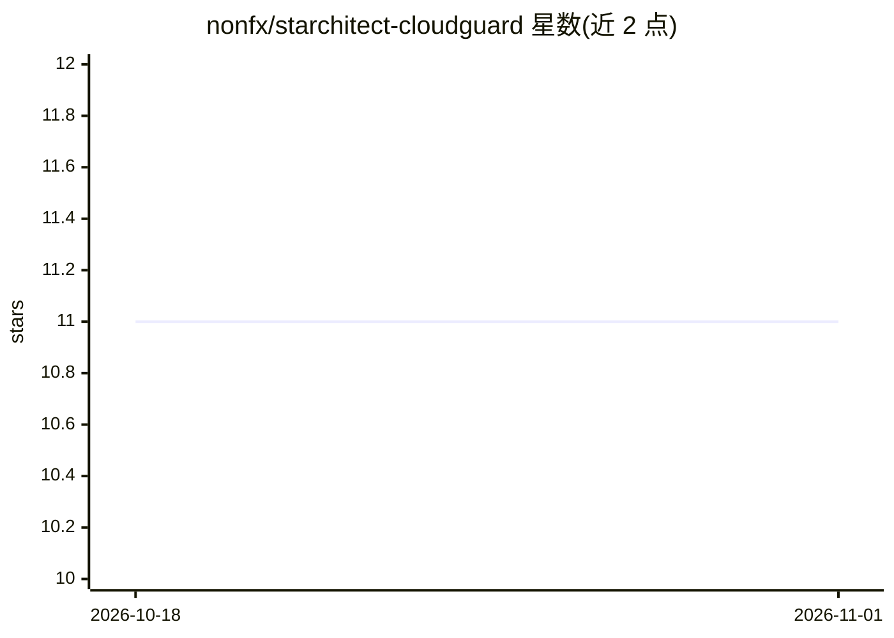

# nonfx/starchitect-cloudguard

⭐ 11 · TypeScript · NOASSERTION · 推送 2026-05-28 · [GitHub](https://github.com/nonfx/starchitect-cloudguard) · [官网](https://starchitect.ai) · 组织维护

**云基础设施安全测试框架：活账目运行时检查+IaC 静态分析**

安全测试框架与 CLI，支持两类检查：对已部署的活云账户做运行时安全检查（当前支持 AWS，GCP/Azure 标注 coming soon），以及对 Terraform 配置做部署前静态分析，覆盖 CIS 与 AWS Foundational 等 5 项安全基准。测试用例由 AI agent 自动生成并经人工评审，AI 用于测试生成环节而非运行时功能。安装支持 npx/npm、Homebrew、deb/rpm 包与独立二进制；运行 AWS 检查需预先配置 AWS 凭证。采用 MIT 基础上加 Commons Clause 的许可，商业转售需另行授权。

## 筛选速览

| 维度 | 判定 | 备注 |
|---|---|---|
| AI 角色 | `ai-enhanced` | 去掉 AI 部分产品仍成立 |
| 许可风险 | `permissive` | NOASSERTION |
| 部署形态 | `library` | 以包/库形式分发 |
| 模型依赖 | — | README 未给出锁定关系 |
| 硬件要求 | — | 无带数字的原话,不猜 |
| 安装摩擦 | `low` | 无编译、无系统依赖或容器化 |
| 成熟度 | `idea` | |

## 能力要点

- 对活云环境运行时检查与 Terraform IaC 静态分析共用同一套测试
- AI agent 生成安全测试用例并经团队人工评审
- 覆盖 CIS AWS/GCP 等 5 项安全基准
- 提供 npm/Homebrew/deb/rpm/独立二进制多种安装方式

## 适用场景

- 在本地开发、CI/CD 与线上环境各阶段跑同一套云安全测试
- 部署前对 Terraform 配置做 CIS 基准合规校验
- 对已上线的 AWS 账户做运行时安全评估

## 场景标签

`网络安全` · 领域:学习与行业

## 证据(README 行号)

> L12: Starchitect-CloudGuard is an AI-powered comprehensive security testing framework with a powerful CLI that lets you 
> L30: - **AI-Powered Test Generation**: Automated creation of high-quality security tests
> L32:  - Meticulous human review by The Non-Functionional Co. team

## 星数曲线

2026-10-18 11 → 2026-11-01 11（+0）

---
*卡片 v1 · prompt 1.4 · 生成 2026-11-01 · 置信度 mid · 依据 README sha `9c3cbb4a90ba` · [字段定义](../../DATASET.md)*
