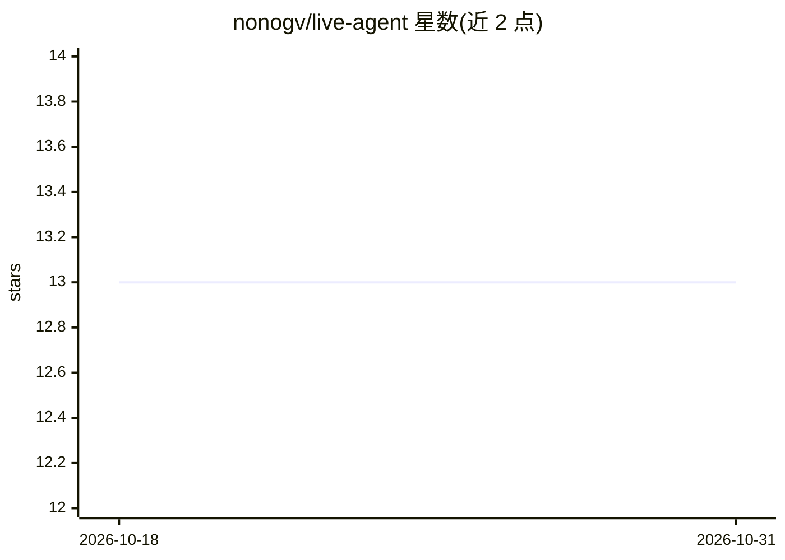

# nonogv/live-agent

⭐ 13 · TypeScript · MIT · 推送 2026-06-08 · [GitHub](https://github.com/nonogv/live-agent) · [官网](https://youtu.be/AFiYc4WvxQU) · 个人维护

**Ableton Live 内置 AI 助手：对话控制音轨、片段与设备**

基于 Ableton Extensions SDK 构建的 Live 12 扩展，在软件内打开聊天面板，由 AI agent 调用 SDK 方法直接操作工程：创建音轨、设置速度、添加片段、调整设备等。工具 schema 从 SDK 类型定义自动生成，覆盖全部 15 个 SDK 类，支持多步调用与错误后续跑，提供 Review/Guard/Auto 三种确认模式和 web 查询功能。支持 OpenAI、Anthropic、Google 提供商，API key 本地存储。限制：需 Live 12.4.5 beta 及以上（Suite 版），从源码构建需 Node.js v24.16.0+。

## 筛选速览

| 维度 | 判定 | 备注 |
|---|---|---|
| AI 角色 | `ai-native` | 本体是模型或模型工具 |
| 许可风险 | `permissive` | MIT |
| 部署形态 | `library` | 以包/库形式分发 |
| 模型依赖 | locked-api |  |
| 硬件要求 | — | 无带数字的原话,不猜 |
| 安装摩擦 | `low` | 无编译、无系统依赖或容器化 |
| 成熟度 | — | 结构信号不足 |

## 能力要点

- 工具 schema 由 SDK 类型自动生成，覆盖全部 15 个 SDK 类
- 多步工具调用链，失败后获取错误继续执行
- Review/Guard/Auto 三种操作确认模式
- 原生撤销：每个 agent 操作可用 ⌘Z 逐步回退

## 适用场景

- 用自然语言批量调整 Live 工程的音轨、片段与设备
- 让 agent 查询吉他谱、混音技巧等制作参考
- 免费 Gemini Flash API key 即可使用，无需订阅

## 场景标签

 · 领域:音乐制作/音频软件扩展

## 证据(README 行号)

> L13: Live Agent opens a chat panel inside Live via the Ableton Extensions SDK. You describe what you want; the agent cal
> L3: An AI assistant built into Ableton Live. Describe what you want in plain English — Live Agent executes it directly o

## 星数曲线

2026-10-18 13 → 2026-10-31 13（+0）

---
*卡片 v1 · prompt 1.4 · 生成 2026-10-31 · 置信度 high · 依据 README sha `18fc15d59234` · [字段定义](../../DATASET.md)*
