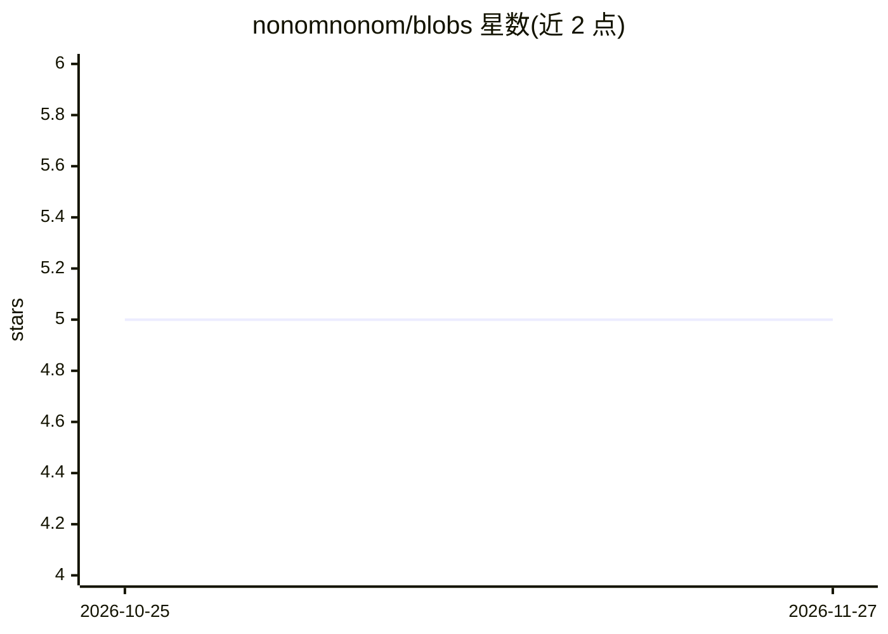

# nonomnonom/blobs

⭐ 5 · Kotlin · Apache-2.0 · 推送 2026-11-21 · [GitHub](https://github.com/nonomnonom/blobs) · [官网](https://nonomnonom.github.io/blobs/) · 个人维护

**离线 Android 研究助手：本地推理、引用检索、语料工具链**

面向 Android 9+ 的离线研究应用：在手机本地维护知识库，支持对库内文档提问并跟随引用阅读原文；对话、文档与模型推理均留在本机，无需账号、不依赖 Google Play Services。用户可导入文本、Markdown、CSV、JSON 与文本型 PDF，可对比并下载多个本地模型；仅模型与库下载需要联网。APK 支持 ARM64 与 x86_64，提供 release 校验和与签名指纹。

## 筛选速览

| 维度 | 判定 | 备注 |
|---|---|---|
| AI 角色 | `ai-native` | 本体是模型或模型工具 |
| 许可风险 | `permissive` | Apache-2.0 |
| 部署形态 | `None` |  |
| 模型依赖 | — | README 未给出锁定关系 |
| 硬件要求 | — | 无带数字的原话,不猜 |
| 安装摩擦 | `low` | 无编译、无系统依赖或容器化 |
| 成熟度 | — | 结构信号不足 |

## 能力要点

- 完全离线推理：对话、文档与模型均留在手机本地
- 检索增强问答：基于本地库回答并附可点击引用
- 支持导入文本/Markdown/CSV/JSON/文本型 PDF 自建语料
- 可对比并选择本地模型，需按手机内存与存储匹配

## 适用场景

- 无网络环境下查询本地资料并核对引用出处
- 在 GrapheneOS 等无 Google Play Services 的设备上运行研究助手
- 用手机整理个人文档库并进行问答检索

## 场景标签

`RAG` `文档问答` · 领域:知识与检索

## 证据(README 行号)

> L5: Blobs is an offline Android research app. Search a local knowledge library, ask questions, and read the sources insi
> L30: - Ask questions using downloaded libraries and follow citations to saved articles.
> L18: 2. Open Blobs. Review the model recommended for your phone, then choose **Download**. You can compare other models 

## 星数曲线

2026-10-25 5 → 2026-11-27 5（+0）

---
*卡片 v1 · prompt 1.4 · 生成 2026-11-21 · 置信度 high · 依据 README sha `69641768d7e3` · [字段定义](../../DATASET.md)*
