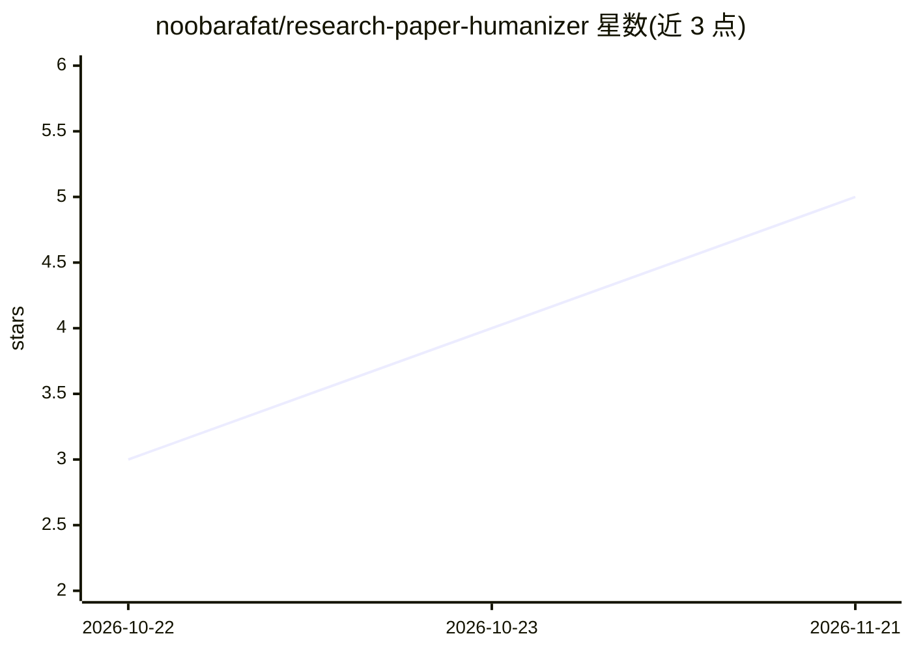

# noobarafat/research-paper-humanizer

⭐ 5 · MIT · 推送 2026-10-16 · [GitHub](https://github.com/noobarafat/research-paper-humanizer) · 个人维护

**降低论文 AI 检测分数的 Claude 改写技能**

面向用 AI 起草学术论文的研究者的 Claude 技能：按 11 条基于语料研究的重写规则（信息顺序、分词尾句、去名词化、句长变化等）做篇章级改写，冻结所有数字、引用与技术术语，并提供 audit/native/check/trim 等模式。安装为 zip 上传 Claude 或 git clone 到 Claude Code；单文件 Markdown，任何支持 Agent Skills 的 agent 或直接作为指令的 LLM 均可用。明确拒绝隐写、错字注入、同义替换等会被判学术不端的手段，并附 IEEE/Elsevier/ACM/Springer 的 AI 使用披露指引。

## 筛选速览

| 维度 | 判定 | 备注 |
|---|---|---|
| AI 角色 | `ai-native` | 本体是模型或模型工具 |
| 许可风险 | `permissive` | MIT |
| 部署形态 | `desktop` | 安装包/桌面程序 |
| 模型依赖 | locked-api |  |
| 硬件要求 | — | 无带数字的原话,不猜 |
| 安装摩擦 | `low` | 无编译、无系统依赖或容器化 |
| 成熟度 | — | 结构信号不足 |

## 能力要点

- 11 条结构化重写规则，数字/引用/术语冻结不改
- 8 个论文章节各有专属改写策略，20+ AI 标记词库
- audit/native/check/trim 四种模式，输出附字数与一致性校验行
- 内置 IEEE/Elsevier/ACM/Springer AI 披露文本模板

## 适用场景

- 为 IEEE、Q1 期刊等投稿改写 AI 起草的章节
- 非母语英语写作者降低被检测器误判的概率
- 用 ChatGPT/Claude/Gemini 起草后润色为个人学术文体

## 场景标签

`AI 写作` `提示工程` · 领域:Agent 开发

## 证据(README 行号)

> L18: **Research Paper Humanizer** is an evidence-based Claude skill. It rewrites AI-assisted research papers so they rea
> L100: The skill is a single Markdown file, `research-paper-humanizer/SKILL.md`. Any agent that supports Agent Skills, or
> L129: 1. Researchers, PhD students and master's students writing for **IEEE conferences, Q1 journals, Elsevier, Springer

## 星数曲线

2026-10-22 3 → 2026-11-21 5（+2）

---
*卡片 v1 · prompt 1.4 · 生成 2026-11-21 · 置信度 high · 依据 README sha `9a97c02e2b3b` · [字段定义](../../DATASET.md)*
